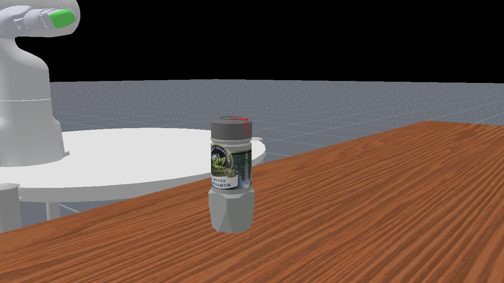
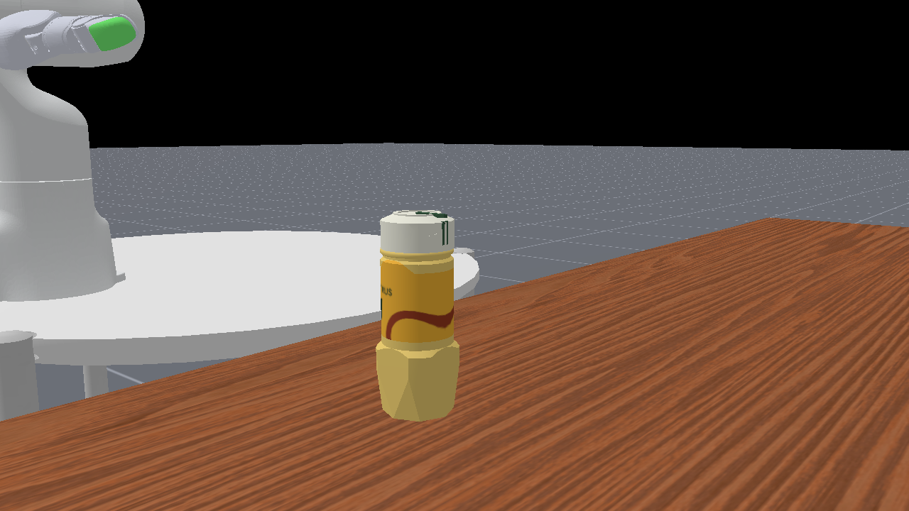
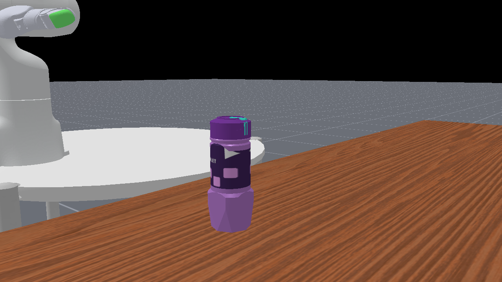
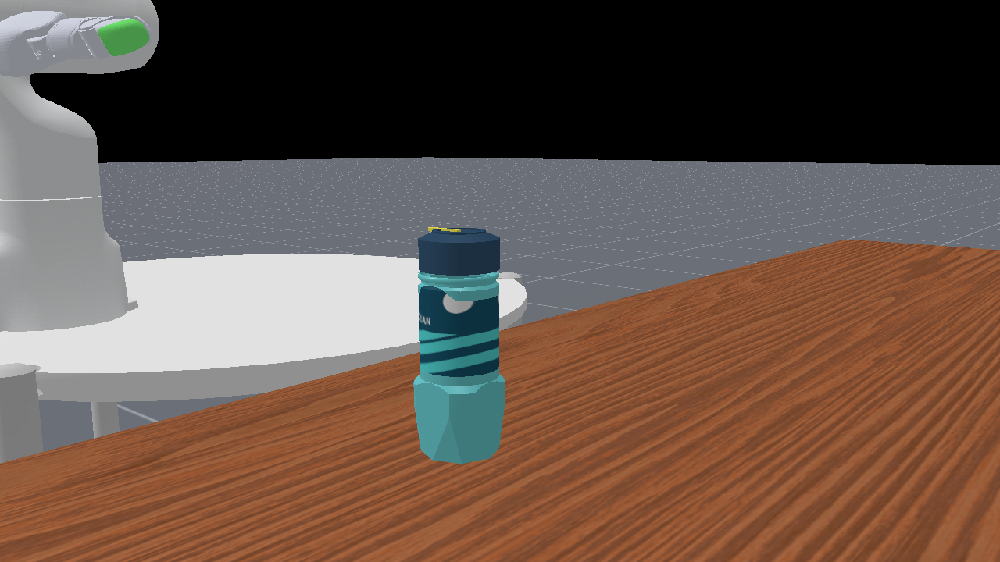

# 历史任务实景对照

复用已验收M2：原版与三方案相同相机、seed7、相同机器人／物体状态。历史为单环境CPU物理＋GPU渲染；本轮没有运行、渲染或服务器连接，不能将这组图当成本轮GPU并行验证。

| 原版 | Ocean | Citrus | Violet |
|---|---|---|---|
|  |  |  |  |

这些是贴图实际绑定后的任务实景，不是独立平面贴图预览。瓶／盖共用此组图，不重复复制；[盖角度参照](../../bottle_cap/previews/README.md)。

开口C为人工调用原表示切换的工程展示，不是机器人完成阶段。[来源与图像哈希](../../../../preview_sources.json)。
