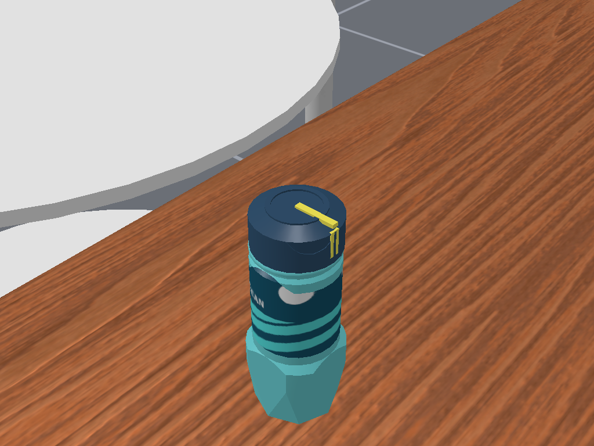
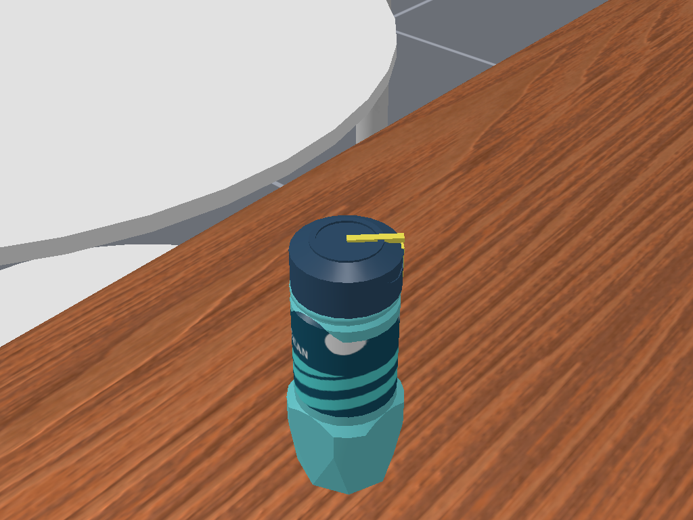
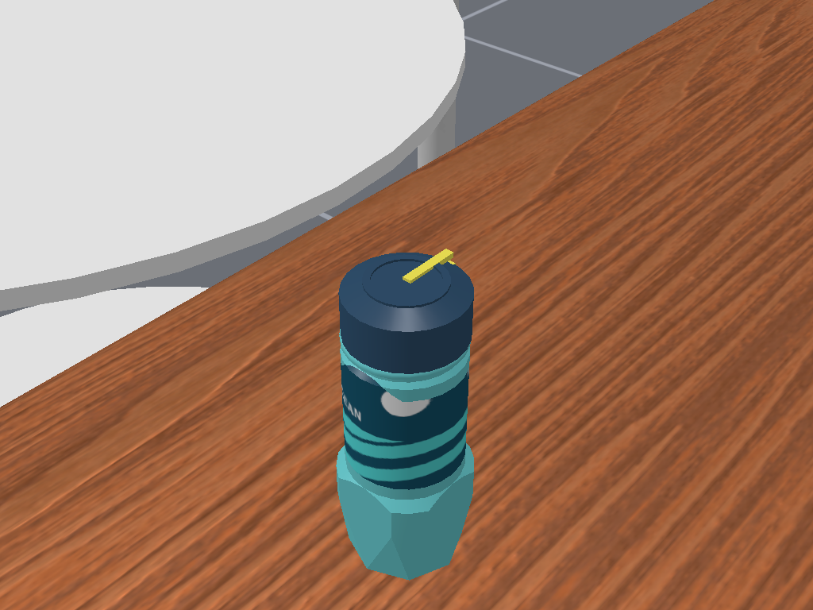
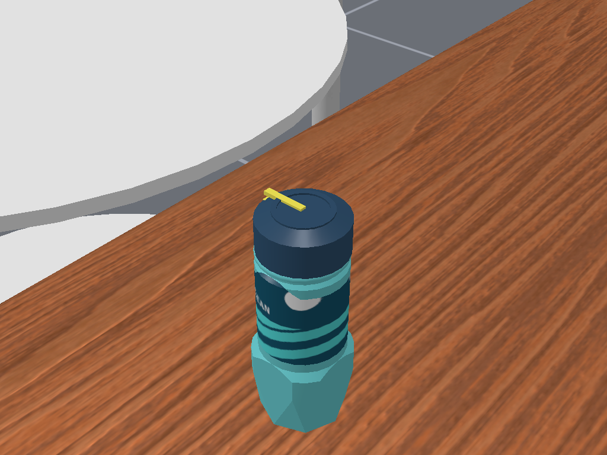
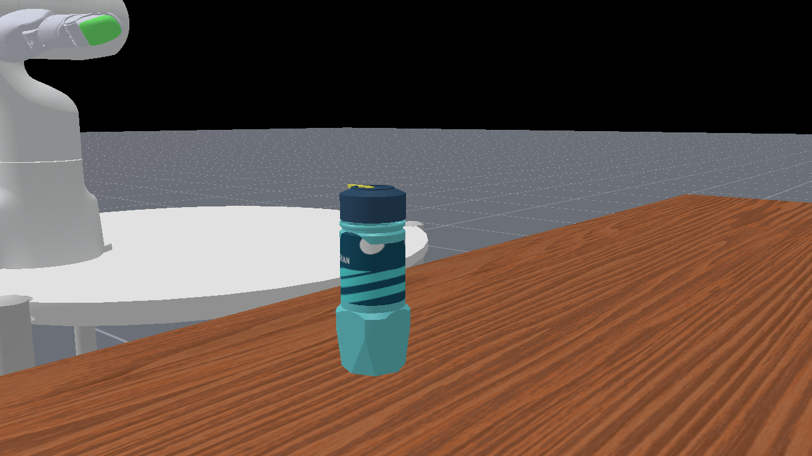

# 历史瓶盖转动参照

原版＋三方案[共用瓶／盖同视角任务图](../../bottle/previews/README.md)。以下复用M2 Ocean近景，人工指定原关节qpos；非机器人拧盖、非任务成功。本轮未重渲染。

| 0° | 45° | 90° | 180° |
|---|---|---|---|
|  |  |  |  |

[实际角度／四元数](angles.json)保存当时读取值（含浮点误差）。黄色偏心顶条与侧刻度为既有box标记改色，可辨认转动程度，不依赖原红条或周期花纹。

自由盖为人工调用原切换函数的工程展示；所有附着／自由表示使用相同逻辑方案。[来源与图像哈希](../../../../preview_sources.json)。
