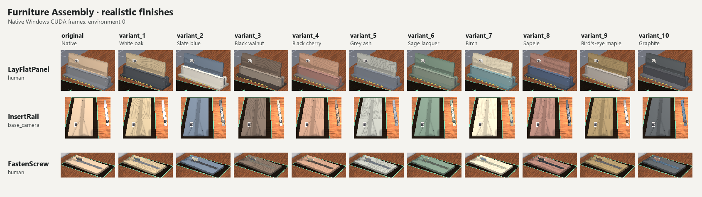

# Furniture Assembly 外观

为板件、导向架、导轨和螺钉提供原版及十套外观，通过 `furniture_appearance` 在建场时绑定每环境私有材质，在 reset 时选择方案并记录。几何、碰撞、质量、关节和任务判定沿用原任务。

## 方案与部件

[运行 catalog](../../tasks/assets/variation/furniture_assembly/v1/catalog.json)版本为 `furniture-appearance-v2`，支持 `original` 和 `variant_1` 至 `variant_10`。各对象 catalog 是材质参数的唯一来源。

| 正式任务 ID | 外观对象 |
|---|---|
| FurnitureAssemblyLayFlatPanel-Sharpa-v1 | 板件、导向架 |
| FurnitureAssemblyInsertRail-Sharpa-v1 | 板件、导轨、十字槽螺钉 |
| FurnitureAssemblyFastenScrew-Sharpa-v1 | 板件、导轨、翼形螺钉 |

| 对象与数值源 | 可变部件与保护范围 |
|---|---|
| [板件](../../assets/appearance/objects/furniture_assembly/flat_panel/README.md) · [catalog](../../assets/appearance/objects/furniture_assembly/flat_panel/variants/v1/catalog.json) | 主面、槽底、封边和槽沿采用同套木饰面或覆面，保留纸标签和条码。 |
| [导向架](../../assets/appearance/objects/furniture_assembly/panel_rack/README.md) · [catalog](../../assets/appearance/objects/furniture_assembly/panel_rack/variants/v1/catalog.json) | 主体和底板使用粉末喷涂、搪瓷漆或镀层，保留垫片、螺栓和黄色警示条。 |
| [导轨](../../assets/appearance/objects/furniture_assembly/rail/README.md) · [catalog](../../assets/appearance/objects/furniture_assembly/rail/variants/v1/catalog.json) | 滑轨和槽唇有各自的阳极氧化、镀镍、镀锌或喷涂效果。 |
| [螺钉](../../assets/appearance/objects/furniture_assembly/screw/README.md) · [catalog](../../assets/appearance/objects/furniture_assembly/screw/variants/v1/catalog.json) | 握持面使用工程塑料或镀层，保留十字槽几何、金色顶帽或黄铜杆与方向顶条。 |

| 方案 | 板件饰面 |
|---|---|
| variant_1 | 白橡木清油 |
| variant_2 | 石板蓝缎面层压板 |
| variant_3 | 黑胡桃木蜡油 |
| variant_4 | 黑樱桃木缎光清漆 |
| variant_5 | 灰洗白蜡木 |
| variant_6 | 灰鼠尾草色喷漆纤维板 |
| variant_7 | 桦木胶合板水性清漆 |
| variant_8 | 沙比利木缎光薄木 |
| variant_9 | 烟草色鸟眼枫木清漆 |
| variant_10 | 石墨灰酚醛层压板 |

[木纹生成器](../../tasks/furniture_assembly/finishes.py)在相同的板件坐标系中按七种木材分别绘制生长轮、导管和木结。三种人工覆面不使用木纹。三块原生盒体主面沿用原生 UV，入口斜块沿用同套颜色与粗糙度。贴图由程序生成，不依赖外部图像。素材风格参考长纹白橡木、深胡桃木和分区涂层。 [Dennis #20](https://github.com/DennisXu626/DexArena-Variation/pull/20) · [RoboDojo 材质库](https://huggingface.co/datasets/RoboDojo-Benchmark/RoboDojo/tree/main/Assets/Material)

[适配器](../../tasks/furniture_assembly/appearance.py)在每个环境的可变部件上更新颜色、粗糙度和金属度，并向主面独立的 albedo 贴图写入外观。原版重放建场捕获的原生贴图像素。原生纯色以相同的浮点值填充贴图，回合间复用贴图句柄。

## 使用

省略配置或设置 `enabled=false` 保留原生材质与 jitter；`original` 恢复本次建场捕获的原生材质。候选在回合初始化后应用并保持固定。

配置优先级：构造公共配置 → 构造 `per_env` → reset 公共配置 → reset `per_env`，环境键使用字符串。`explicit` 指定 `scheme_id`；`random_choice` 从非空 `scheme_ids` 中选择。`enabled` 和外观随机源 `seed` 仅构造时生效。

[default](../../examples/variation/furniture_assembly/default.json)、[fixed](../../examples/variation/furniture_assembly/fixed.json)、[random](../../examples/variation/furniture_assembly/random.json)示例包含 `task_id` 与构造参数；加载 JSON 后先取出 `task_id`。

GPU 局部 reset 要求 SDK 原生函数 `sapien.physx.indexed_gpu_apply_patch_version()` 返回 `1`。Windows 验证包为 `3.0.3+dexarena.gpu1.wininterop5`；构建与加载方法见 [SDK 说明](../../tools/variation/sapien_sdk/README.md)。CPU 不受此能力检查影响。

先在同一进程执行 [SDK 说明](../../tools/variation/sapien_sdk/README.md)的普通脚本加载片段，再运行：

```python
import torch
torch.cuda.init()
import gymnasium as gym
import tasks

env = gym.make(
    "FurnitureAssemblyLayFlatPanel-Sharpa-v1",
    num_envs=2, sim_backend="physx_cuda", obs_mode="rgb", render_mode="rgb_array",
    reconfiguration_freq=0,
    furniture_appearance={"enabled": True, "mode": "explicit", "scheme_id": "variant_10",
                          "per_env": {"1": {"scheme_id": "variant_3"}}},
)
env.reset(seed=7)
env.reset(options={
    "env_idx": torch.tensor([1], device=env.unwrapped.device),
    "furniture_appearance": {"mode": "explicit", "scheme_id": "original"},
})
records = env.unwrapped._furniture_appearance.records
env.close()
```

`records` 追加 `env_idx`、`episode_index`、`scheme_id`、`catalog_version`；回合索引按环境递增，包含构造时的初始化。选中环境的外观请求在抽样和材质更新前统一校验。局部 reset 按环境索引更新任务随机流、物理状态及[控制器目标](../../tasks/robots/franka_joint_impedance_controller.py)，外观开关关闭时同样生效。

## 验证与复现

旧版外观的证据保留其输入提交、SDK 和原相机画面。 [十套旧版](../../assets/appearance/furniture_assembly/previews/runtime_finishes/summary.json) · [首批旧版](../../assets/appearance/furniture_assembly/previews/runtime/summary.json)

新版检查覆盖三个短任务的全部固定方案、随机选择和原版恢复。Linux CUDA 使用两个环境和任务原生相机读回，逐套检查独立贴图及 RGB 的原版恢复，并交替对两个环境做局部 reset。正式任务与预览共用木纹生成器。

### Windows 实拍与复核

冻结输入 `c92d404b5acd5ec5491d1740fa13ab920f8a9c06` 已通过三个短任务的 CPU 接口及标准 Windows CUDA 双环境检查。十套候选逐套恢复原版时，材质、物理状态和原生相机 RGB 一致。两个环境分别进行局部 reset，复核未选环境的材质、状态、随机流和画面。[运行与复核哈希](../../assets/appearance/furniture_assembly/previews/realistic/windows_native_review.json)

CPU 动态按每任务 13 组执行相同动作，覆盖两次关闭外观对照、原版和十套候选。复算 2,340 个控制步、46,800 个物理子步与 2,379 个初始及逐步快照，各组状态和奖励与原生对照逐元素一致。



对照图按任务固定裁剪原生相机 RGB，保持比例缩放。每任务每环境复算十套候选之间的 45 对差异。按裁剪内每通道平均绝对差排序，最接近的方案仍有下列像素差异。裁剪内包含少量桌面和放置区域。

| 任务 | 相机 | 最近候选 | env0 变化像素 | env1 变化像素 |
|---|---|---|---:|---:|
| LayFlatPanel | human | variant_4 / variant_6 | 7,830 / 15,052 | 7,780 / 15,052 |
| InsertRail | base_camera | variant_2 / variant_6 | 6,974 / 14,616 | 7,140 / 14,616 |
| FastenScrew | human | variant_8 / variant_9 | 4,391 / 13,588 | 4,522 / 13,588 |

从仓库根目录运行。每次选择新的输出目录。

```bash
python -B tools/variation/check_furniture_appearance.py --static
python -B tools/variation/check_furniture_appearance.py --approved-runtime --sim-backend physx_cpu --output outputs/furniture_interface
python -B tools/variation/check_furniture_dynamics.py --steps 60 --seed 7 --output outputs/furniture_dynamics
```

Linux CUDA 按 [Linux 验收入口](FURNITURE_LINUX_RESET.md)执行。Windows CUDA 按 [SDK 验证入口](../../tools/variation/sapien_sdk/README.md)加载私有 v5 SDK。验证入口默认遍历三个短任务，也可用 `--task` 逐任务采集。预览工具支持 `--scheme variant_7`，窗口中 `N`、`B` 切换方案，`V` 切换固定视图。
