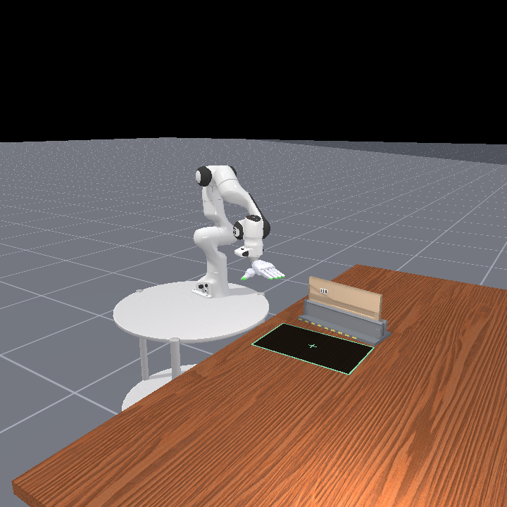
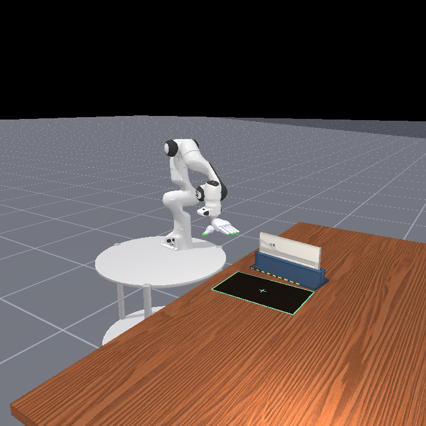
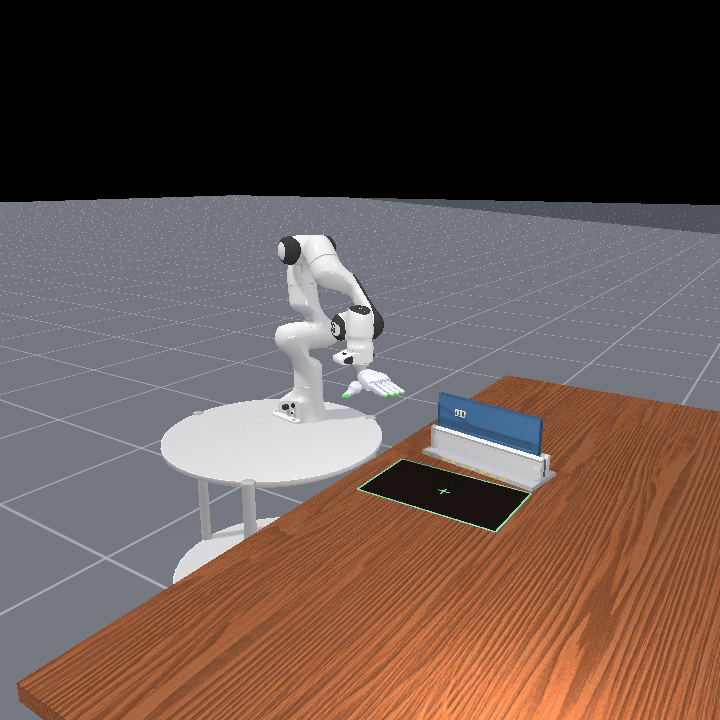
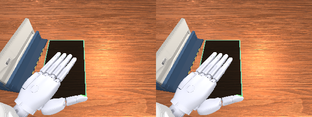
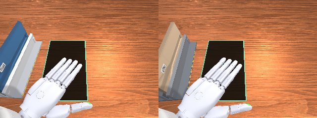

# Furniture Assembly 外观

为板件、导向架、导轨和螺钉提供原版及两套外观，通过 `furniture_appearance` 在建场时绑定每环境私有材质，在 reset 时选择方案并记录。几何、碰撞、质量、关节和任务判定沿用原任务。

## 方案与部件

[运行 catalog](../../tasks/assets/variation/furniture_assembly/v1/catalog.json)版本为 `furniture-appearance-v1`，统一方案为 `original`、`variant_1`、`variant_2`；各对象 catalog 是唯一数值源。

| 正式任务 ID | 外观对象 |
|---|---|
| FurnitureAssemblyLayFlatPanel-Sharpa-v1 | 板件、导向架 |
| FurnitureAssemblyInsertRail-Sharpa-v1 | 板件、导轨、十字槽螺钉 |
| FurnitureAssemblyFastenScrew-Sharpa-v1 | 板件、导轨、翼形螺钉 |

| 对象与数值源 | variant_1 / variant_2 | 可变与保留部件 |
|---|---|---|
| [板件](../../assets/appearance/objects/furniture_assembly/flat_panel/README.md) · [catalog](../../assets/appearance/objects/furniture_assembly/flat_panel/variants/v1/catalog.json) | 浅象牙 / 深蓝 | 改主面、槽底、封边、槽沿；保留标签与条码 |
| [导向架](../../assets/appearance/objects/furniture_assembly/panel_rack/README.md) · [catalog](../../assets/appearance/objects/furniture_assembly/panel_rack/variants/v1/catalog.json) | 深蓝 / 浅灰白 | 改主体与底板；保留垫片、螺栓、黄条 |
| [导轨](../../assets/appearance/objects/furniture_assembly/rail/README.md) · [catalog](../../assets/appearance/objects/furniture_assembly/rail/variants/v1/catalog.json) | 深蓝 / 香槟铜 | 改主体与槽唇，仅绑定 rail_body |
| [螺钉](../../assets/appearance/objects/furniture_assembly/screw/README.md) · [catalog](../../assets/appearance/objects/furniture_assembly/screw/variants/v1/catalog.json) | 深青 / 砖红 | 改头部握持面；保留十字槽几何、金色顶帽或黄铜杆与方向顶条 |

[适配器](../../tasks/furniture_assembly/appearance.py)仅覆盖可变部件的 `base_color`、`roughness`、`metallic`。各对象 `bindings.json` 保存角色及任务表示。方案使用程序材质，无新增贴图、模型或字体；代码与原资产许可分别见 [LICENSE](../../LICENSE)和[资产说明](../../tasks/assets/README.md)。

## 使用

省略配置或设置 `enabled=false` 保留原生材质与 jitter；`original` 恢复本次建场捕获的原生材质。候选在回合初始化后应用并保持固定。

配置优先级：构造公共配置 → 构造 `per_env` → reset 公共配置 → reset `per_env`，环境键使用字符串。`explicit` 指定 `scheme_id`；`random_choice` 从非空 `scheme_ids` 中选择。`enabled` 和外观随机源 `seed` 仅构造时生效。

[default](../../examples/variation/furniture_assembly/default.json)、[fixed](../../examples/variation/furniture_assembly/fixed.json)、[random](../../examples/variation/furniture_assembly/random.json)示例包含 `task_id` 与构造参数；加载 JSON 后先取出 `task_id`。

GPU 局部 reset 要求 SDK 原生函数 `sapien.physx.indexed_gpu_apply_patch_version()` 返回 `1`。Windows 验证包为 `3.0.3+dexarena.gpu1.wininterop5`；构建与加载方法见 [SDK 说明](../../tools/variation/sapien_sdk/README.md)。CPU 不受此能力检查影响。

先在同一进程执行 [SDK 说明](../../tools/variation/sapien_sdk/README.md)的普通脚本加载片段，再运行：

```python
import torch
torch.cuda.init()
import gymnasium as gym
import tasks

env = gym.make(
    "FurnitureAssemblyLayFlatPanel-Sharpa-v1",
    num_envs=2, sim_backend="physx_cuda", obs_mode="rgb", render_mode="rgb_array",
    reconfiguration_freq=0,
    furniture_appearance={"enabled": True, "mode": "explicit", "scheme_id": "variant_1",
                          "per_env": {"1": {"scheme_id": "variant_2"}}},
)
env.reset(seed=7)
env.reset(options={
    "env_idx": torch.tensor([1], device=env.unwrapped.device),
    "furniture_appearance": {"mode": "explicit", "scheme_id": "original"},
})
records = env.unwrapped._furniture_appearance.records
env.close()
```

`records` 追加 `env_idx`、`episode_index`、`scheme_id`、`catalog_version`；回合索引按环境递增，包含构造时的初始化。选中环境的外观请求在抽样和材质更新前统一校验。局部 reset 按环境索引更新任务随机流、物理状态及[控制器目标](../../tasks/robots/franka_joint_impedance_controller.py)，外观开关关闭时同样生效。

## 验证与复现

[正式运行证据](../../assets/appearance/furniture_assembly/previews/runtime/summary.json)记录版本、源码哈希与三任务结果。

| 检查 | 实测结果 |
|---|---|
| CPU 动态对照 | 三任务 × 四种设置，720 control steps / 14400 physics steps；初态、逐步物理状态、关节目标、任务记录及 success/reward 数值差 0 |
| GPU 双环境 | 三任务各 2 环境，6 control steps / 120 physics steps；原 ManiSkill 标准 CUDA RGB，66 次选中环境检查通过 |
| 未重置 env0 | 物理状态、每环境控制器缓冲、任务与外观随机流、RGB 均精确保持，最大差 0 |
| original 恢复 | 两环境原相机 RGB 最大差 0 |
| 选中环境读回 | actor/articulation 物理状态最大绝对误差约 `2.3841858e-7`；`rtol=0`、`atol=2e-6` |

[Mouse 兼容性](evidence/furniture_assembly/mouse_compatibility_20261117.json)在同一 SDK 上通过原验收及 main 对照，3308 个张量值与 12 对图像完全一致。Mouse 原有的强动态局部隔离缺口仍在。共享控制器改变采集代码指纹，数据使用独立版本目录。

### 任务图像

LayFlatPanel 的 `human` 相机、env0，同初态与光照。板件和导向架随方案变化，标签、条码、垫片及黄条保留。

| original | variant_1 | variant_2 |
|---|---|---|
|  |  |  |

局部 reset 使用各环境的 `base_camera`；每行左图为 reset 前，右图为 reset 后。仅重置 env1，比较期间无物理步进；env0 RGB 逐像素不变，env1 从 `variant_2` 恢复 `original`。

| 环境 | 左：reset 前 · 右：reset 后 |
|---|---|
| env0，保持 variant_1 |  |
| env1，variant_2 → original |  |

[InsertRail 图像](../../assets/appearance/furniture_assembly/previews/runtime/InsertRail/)和[FastenScrew 图像](../../assets/appearance/furniture_assembly/previews/runtime/FastenScrew/)覆盖相应导轨与螺钉表示。图像用于外观及隔离核对，未表示机器人完成任务。

### 复现

CPU 动态对照使用新输出目录复现：

```bash
python -B tools/variation/check_furniture_dynamics.py --output outputs/furniture_cpu_check --steps 60 --seed 7
```

GPU 双环境验收使用 [SDK 验证入口](../../tools/variation/sapien_sdk/README.md)。[部件近景](https://github.com/DennisXu626/DexArena-Variation/tree/435f835038d22cfe21b452681747cf3d85d6a67c/assets/appearance/furniture_assembly/previews/author_check_20261116)保留标签、槽口和螺钉参照的对照。

Long、Linux 编译运行及完整机器人任务成功尚未验收。
