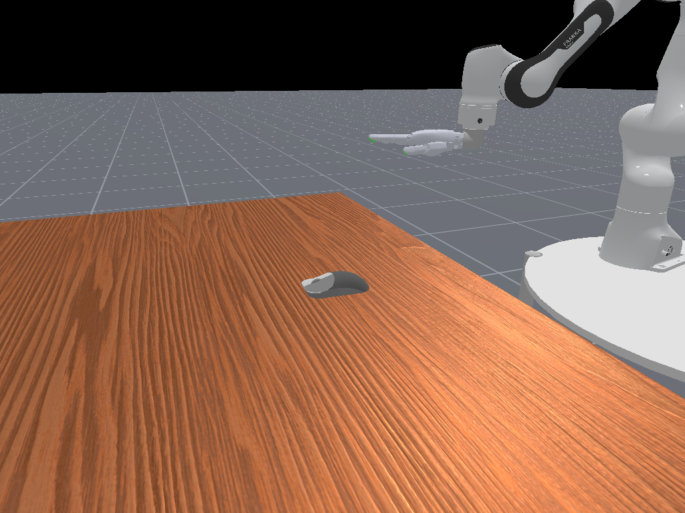
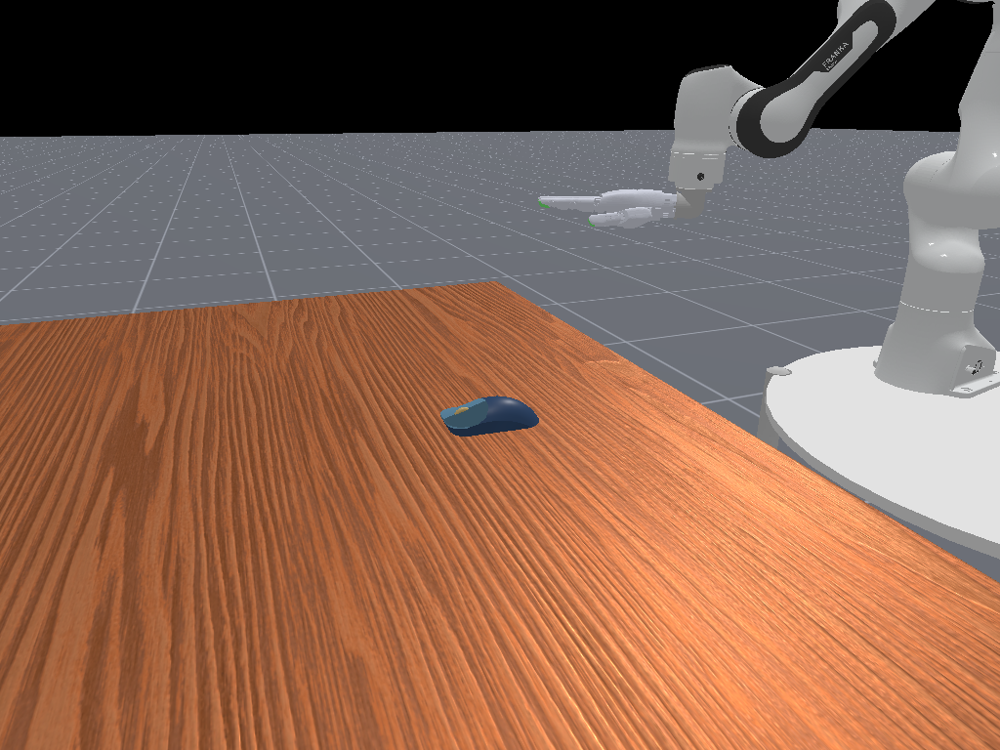

> **最新结果（2026-11-16）**：本页末尾“时序修复与一次复测”已有限运行通过，待Dennis验收；此前准备和失败段落保留当时结论。

# Mouse 101408：ClickMouse 最小外观入口（待运行验收）

仅适用 `OfficeDeskClickMouse-Sharpa-v1`。本轮准备了代码、方案与短检脚本，GPU 使用为 0；尚无新实景、物理等价或局部 reset 隔离通过结论。不接入 OfficeDeskLong，不代表 A6 或机器人点击成功。

## 配置与默认

构造 kwargs 为 `mouse_appearance`；省略、`None` 或 `enabled: false` 委托原任务，无外观 RNG、材质绑定或外观 reset 写入。启用后可指定 `scheme_id`（original／ivory_matte／navy_satin），或 `mode: random_choice` 配合非空 `scheme_ids`。独立外观 RNG 由配置 `seed` 与 env 索引构造，不消耗原任务采样流；复现条件为相同配置、环境数和 reset 顺序，`env.reset(seed=...)` 不重置这条独立外观流。

`per_env` 使用字符串环境索引。局部 reset 通过 `options['mouse_appearance']` 覆盖本次选中环境，优先级为构造公共项→构造 per_env→reset 公共项→reset per_env。非选中环境不重抽。回合中不更新；重建场景重新绑定后恢复选中方案。运行启用后可读取 `env.unwrapped._mouse_appearance.schemes`、`.catalog['version']` 和 `.records`（每回合 env_idx、episode_index、scheme_id、catalog_version）。记录为本进程小型列表，调用者应按批导出后清空，不用于无限常驻日志。

[默认示例](../../examples/variation/office_desk/mouse_101408/default.json)、[双环境固定方案](../../examples/variation/office_desk/mouse_101408/fixed.json)、[随机示例](../../examples/variation/office_desk/mouse_101408/random.json)。这些是接口准备示例，尚未获实际运行验证。

```python
import gymnasium as gym
import tasks
# 以下代码仅在资源获批后执行；导入任务也可能生成派生资源。
env = gym.make('OfficeDeskClickMouse-Sharpa-v1', num_envs=2,
               sim_backend='physx_cuda', reconfiguration_freq=0,
               obs_mode='rgb', render_mode='rgb_array',
               mouse_appearance={'enabled': True, 'scheme_id': 'ivory_matte',
                                 'per_env': {'1': {'scheme_id': 'navy_satin'}}})
```

## 资产与材质绑定

任务实际路径为 `MOUSE_ASSET_DIR/101408/mobility.urdf`，原缩放 0.08 不变；不用 mobility_planar_mouse.urdf。[唯一方案源](../../tasks/assets/variation/office_desk/mouse_101408/v1/catalog.json)只包含原创 scalar 渲染参数，无新增纹理、UV、模型或外部素材。来源模型遵守原对象包许可，不随本 PR 分发。

| URDF link | 源视觉 OBJ | 外观角色 |
|---|---|---|
| link_0 | original-3.obj | buttons |
| link_1 | original-4.obj | buttons |
| link_2 | original-5.obj | wheel |
| link_3 | original-2.obj、original-1.obj | shell |

base 无视觉。缓存静态解析显示所有 OBJ 无 UV、每个一个 material_0_0，名称相同但原 Kd 不同。original 按实际 loader 材质逐部件恢复，不用统一灰色覆盖。任务自有 LinkBuilder 在加入场景前生成独立材质，再绑定实际 link；不修改核心库，不替换或新增 render shape、几何及碰撞。读取一次未挂载原生 render component 复制材质，再用同一 visual_records 原生构建；真实 SAPIEN 3.0.3 的形状／部件对应仍须短检确认，遇不符明确失败。

官方当前 [render.pyi](https://github.com/haosulab/SAPIEN/blob/master/python/py_package/pysapien/render.pyi)显示 mesh-part.material 只读，因此未通过它替换材质；该阅读不替代已安装版本验证。物理、关节、机器人、初态采样及成功判断的原代码保留。

## 检查与待批准短检

[本轮静态检查结果](evidence/mouse_101408/preparation.json)。这不是运行验收。

CPU 准备：

```bash
python -B tools/variation/check_mouse_101408.py --static
python -B tools/variation/check_static.py
python -B tools/variation/check_appearance_archive.py
```

静态对照需要 main 基准 `00a3695193680e0bfc0d37b8c77986b2fbfb8357`（浅克隆先 fetch 该对象）。既有 Charger 检查所需历史对象仍按 SETUP 获取。

获批准并通过现有调度规范分配单卡后，在**私有可写资产副本**上执行：

```bash
python -B tools/variation/check_mouse_101408.py --approved-runtime --output outputs/mouse_101408/run_001
```

`--approved-runtime` 是显式意图保护，不是资源授权；本轮未运行该命令。用现成环境，不升级依赖。MOUSE_ASSET_DIR 指向 office 目录，且其中 101408 及 COACD 缓存须可写；不能指向共享只读资产，不能把新缓存写回共享源。首次分解有成本，计入 GPU 作业时限，不无限重试。

脚本只用原相机、无物理 step，保存 native 状态/碰撞/质量/惯量/视觉网格指纹、方案与记录、固定及局部 reset RGB、失败栈和加载/reset/render耗时。以已安装 API 为准；如确定性失败，保存证据并停止，授权范围内最小修正后仅补失败项。检查原版初始 get_info 等价及 AST 成功判断不变，不构造或宣称机器人成功。

拟申请单卡 GPU 累计最多600秒（含失败、启动、COACD、渲染及验证），后续非GPU最多75分钟；须 Dennis 明确批准才提交作业，不使用历史余额。先检查遗留作业与可写资产及缓存；设置调度硬时限与单次脚本 timeout，有限 stdout/stderr 写私有工作目录，预算内失败即止。准备工作没有联系服务器或提交任务。

## 回退

本 PR 不合并 main。回退为关闭或省略 mouse_appearance，直接沿用原路径；代码回退时撤销本 PR 提交，不触碰原对象包、其它任务或共享安装。实测之前 catalog 和档案均保留 runtime_unverified／待适配状态。

## 2026-11-16恢复状态

[源码恢复与CPU证据](evidence/mouse_101408/recovery_001.json)：冻结提交358b4de5d7036a03bcfee025ee679c03da6f7239的完整目标工作树、原commit/tree以及静态参考浅层对象已核对，git fsck通过；原gitlink保留，未下载其子仓库。550文件复用匹配内容，107文件按目标blob补齐。

私有coacd1.0.11的基准Python CPU导入、停止保护及只读库文件绑定CPU检查已有证据；这些不验证GPU/渲染。Dennis已接受无Ceph配额监测模式和一次累计600GPU秒，但本轮因提交前包装器错误及修正后的余时门槛，**没有提交GPU作业**。GPU用量0，A4/A5/完整点击/A6仍未验证；不合并。本次文档更新不修改上述冻结运行文件。

## 2026-11-16 唯一 GPU 短检结果（待 Dennis 验收）

[结构化运行结果](evidence/mouse_101408/run_001.json)：唯一作业 **86071** 已以 FAILED / 1:0 结束，单卡分配 **10 秒**，未自动重启、未再次提交。冻结运行提交仍为 `358b4de5d7036a03bcfee025ee679c03da6f7239`，本次仅更新文档与证据，生产实现及验证脚本未变。

首个关闭 variation 的原生双环境 `physx_cuda` 场景创建失败：`office_desk_click_mouse.py:745` 调用 `joint.set_drive_target`，在 `articulation_joint.py:261` 的 `cuda_articulation_target_qpos.torch()` 报 `ValueError: cannot parse typestr`（异常原文中的 typestr 带反引号）。尚未进入外观启用路径；具体根因未确定，没有修改核心库或任务行为。

original／ivory_matte／navy_satin 实际绑定与 RGB、固定／随机复现、物理初态等价和局部 reset 隔离 **均未到达，不能判通过**。未生成 RGB 对照，没有物理步进，不代表机器人点击成功或 A6。原 PGID 清理完成，随后队列为空且原 PGID 不存在；跨 PGID 后代完整控制仍未证明。日志保留 543 字节，监测未触发容量或超时停止；768 MiB 是采样停止阈值，非绝对硬封顶。

实际运行 manifest 的生产文件哈希、源资产及缓存前后核对一致。GPU 计账来自已缓存的完整终态 scontrol（Start/End/RunTime）；sacct 数据库不可用，后续 scontrol 已清除该作业，均保留原始证据。完整栈、manifest、终态、容量与成本保存在本机交付 `deliverables/mouse_101408/runtime_001/shortcheck_001/`。PR 保持草稿，待 Dennis 决定后续；一次作业授权已消耗，剩余 590 秒不能自行用于第二次作业。

## 2026-11-16 时序修复与一次复测：限定检查通过，待 Dennis 验收

冻结运行提交 `78c9b2f212a50f4a9249acd30993dd9c6940d467`，相对358b4de只修改ClickMouse目标写入时机及现有验证脚本。CPU仍在原_load_scene位置设置原目标；GPU在已有_after_reconfigure每mouse循环、qpos写入前用保存的左右release目标调用原setter。驱动参数、碰撞、质量、机器人、初始采样和成功判定未改；普通/局部reset没有新增全环境target写入。精确反向登记这两处迁移及剥除外观钩子后，任务AST与原版一致，Long不变；整仓/档案静态检查通过。

唯一复测作业 **86453**，COMPLETED / 0:0 / Restarts0，单卡分配 **25秒**；此前失败86071计10秒，累计35/600秒。应用17.38秒、guard24.28秒分别记录，不能代替分配秒。使用相同既有包版本，physx_cuda、2环境，没有训练或用户env.step；框架内部gpu_init仍含warm-start。

[结构化实际结果](evidence/mouse_101408/retest_001.json)：省略外观的原生构建/reset、显式关闭、original/ivory_matte/navy_satin实际部件材料与RGB、同seed物理初态和驱动目标对照、随机复现与回合记录、两轮只reset env1的A5均通过。初始化后缓冲为f4，shape[4,29]、strides[116,4]、cuda_id0、指针非零；两环境左右目标均与各自保存release值0相符，qvel为0。修复后通过支持时序解释；未采集失败时的typestr，不把推断写成实测。

两轮A5里env0状态、target、材质与记录不变，base_camera/wrist_camera/human保存图独立CPU像素比较均为0；env1方案准确切换为original、再ivory_matte，三路图均有变化。三方案任务实景如下，原完整分辨率、同seed/相机，未经生成式修改：

| original | ivory_matte | navy_satin |
|---|---|---|
|  |  |  |

原PGID清理complete、无存活成员，本线作业已结束；队列中其他健康作业未动。日志1579B，目录最终149355924B，监测未触限；768MiB约1秒采样不是绝对封顶。测试沿用只读资产/依赖与原保护函数，新增轮次入口只调用原run_owned并收紧应用240秒、Slurm300秒，历史授权/提交标记保留。Monica首次超时后一次新鲜查询成功；所有卡有负载，按集群允许共享方式选择空闲shard/至少16GiB显存余量的最低负载卡，未更改运行停止保护。

本轮未验证Long、CPU运行、机器人点击/完整任务、A6、大规模环境或内部warm-start轨迹等价。PR只交验，不合并；当前结论是限定检查通过、待Dennis验收。完整30张PNG、状态PT、manifest、静态/终态/容量与成本见本机 `deliverables/mouse_101408/retest_001/`。关闭外观仍会采用这个已经公开区分的时序修复，不称为完全未修改上游。
