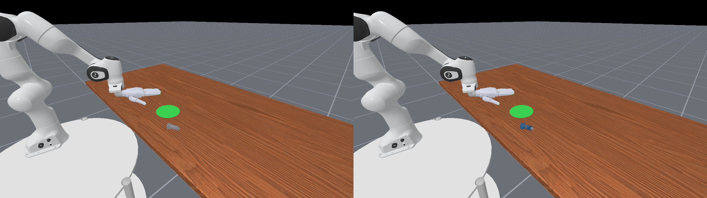
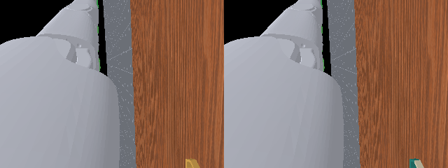
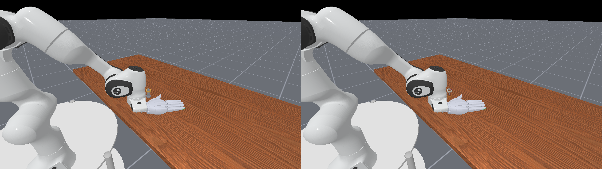
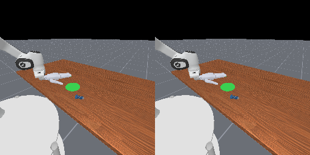
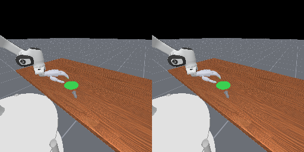

# Nut & Bolt 外观

三个短任务提供默认关闭的 `nut_bolt_appearance` 接口，每个可见对象支持 `original` 与 `variant_1`–`variant_10`。外观只修改允许角色的 base color RGB、roughness 和 metallic。两种螺母表示使用同一个方案。新增方案与复现入口见 [扩容记录](NUT_BOLT_EXPANSION.md)。

## 使用

```python
import gymnasium as gym
import tasks

env = gym.make(
    "NutBoltSeatNut-Sharpa-v1",
    sim_backend="physx_cpu",
    num_envs=1,
    nut_bolt_appearance={"enabled": True, "scheme_id": "variant_1", "seed": 71},
)
env.reset(seed=7)
env.reset(options={"nut_bolt_appearance": {"scheme_id": "original"}})
records = env.unwrapped._nut_bolt_appearance.records
```

省略配置或 `enabled=False` 保留原任务行为，不准备外观材质或记录器。`enabled`、外观 `seed` 在构造时确定；任务 seed 与外观 RNG 独立。

选择优先级为构造公共 → 构造 `per_env` → reset 公共 → reset `per_env`。`per_env` 的键为从 `"0"` 到最后一个环境编号的规范字符串，值为配置字典。`mode="random_choice"` 与非空 `scheme_ids` 支持指定集合抽样；显式方案不消耗外观 RNG。各环境单独计数，每条回合记录含 `env_idx`、`episode_index`、`scheme_id`、`catalog_version`。render 不重抽。

公开 `reset` 先按上述优先级校验所有选中环境的有效方案。显式 ID 和随机列表中的每个 ID 均须在运行 catalog 中。校验通过后才进入原生重置，外观抽样和应用仍在任务初始化结束时进行。显式 `env_idx` 必须严格递增，局部 reset 必须省略任务 `seed`。直接恢复原生状态可使用 `reset_to_env_states`，与外观覆盖互斥。

配置示例见 [default](../../examples/variation/nut_bolt/default.json)、[fixed](../../examples/variation/nut_bolt/fixed.json)、[random](../../examples/variation/nut_bolt/random.json) 和[双环境新增方案](../../examples/variation/nut_bolt/expansion.json)。

## 对象与绑定

| 任务 | 实际表示 | 可改角色 | 保护内容 |
|---|---|---|---|
| PickBolt | bolt Actor，214 visuals／各1 part | shaft 0、head 213 | tip 1–20、thread 21–212 |
| SeatNut | bolt；nut Actor；threaded_nut link | bolt同上；两螺母同方案 | 原生双表示切换和可见性 |
| TurnNut | bolt；nut Actor；threaded_nut link | 同上 | 原生锁轴、固定根和转动关节 |

螺母两表示各6个box：既有segment 0作为候选的对比参照面，其余5段为body。不开新孔，不新增参照几何。隐藏twin继续由原任务控制，不能为截图显露；bolt_platform没有视觉。

运行索引 [catalog](../../tasks/assets/variation/nut_bolt/v1/catalog.json)只映射对象和方案；唯一数值源为 [bolt catalog](../../assets/appearance/objects/nut_bolt/bolt/variants/v1/catalog.json) 与 [nut catalog](../../assets/appearance/objects/nut_bolt/nut/variants/v1/catalog.json)。完整部件、原资产身份及保护规则见 [bolt bindings](../../assets/appearance/objects/nut_bolt/bolt/bindings.json)、[nut bindings](../../assets/appearance/objects/nut_bolt/nut/bindings.json)。没有新增UV或贴图，original从本次实际加载材质捕获并恢复。

## 原 PR #15 两套候选的验证

[Windows v7 验收记录](../../assets/appearance/objects/nut_bolt/previews/runtime/summary.json)覆盖三项短任务。各通过 40 次选中状态读回及 2 控制步／40 物理步。两种局部 reset 方向均核对未选环境的状态、控制器、RNG、材质及 RGB。四个原生相机的未选环境、original 恢复和重复帧 RGB 均逐值一致。SeatNut 另核对原生 free／threaded 切换的首帧、重复帧与反向局部 reset。

CPU 接口和动态回归通过。三个任务的五组同动作对照共 900 控制步／18,000 物理步，所有逐步动态状态与重复原任务基线精确一致，各组材质保持稳定。

| 任务 | Reset seed | 候选可见性见证 |
|---|---:|---|
| PickBolt | 7 | 原 `base_camera` |
| SeatNut | 1 | 原 `wrist_camera`；两个环境分别见到 231、68 个活动螺母分割像素 |
| TurnNut | 26 | 原人视相机；两环境的螺栓／活动螺母分割像素分别为 482／213 和 465／209 |

SeatNut 与 TurnNut 的任务视角会被机械臂遮挡。先用关闭外观的原生 reset 和分割选择可见布局，再在同一原生视角验证两个候选各自区别于 original、也彼此可分。四个相机都参加隔离和恢复对照。布局预查与 SeatNut 切换验证不代表机器人策略完成任务。

各图左侧为对照，右侧为候选或局部 reset 后。TurnNut 的着色螺栓和螺母位于机械臂腕部右侧。











## 复现

静态检查、公开 reset 契约、CPU 动态、双环境 CUDA 和 SDK 探针的命令见 [扩容验证命令](NUT_BOLT_EXPANSION.md#验证命令)。

[独立 SDK 验证记录](../../assets/appearance/objects/nut_bolt/previews/runtime/sdk_probe_checks.json)覆盖 [原生六轴锁定](../../tools/variation/sapien_sdk/native_lock/probes/check_runtime_lock.py) 的锁定、解锁、索引恢复和真实接触，以及 [光栅可见性](../../tools/variation/sapien_sdk/native_lock/tools/probe_batched_visibility.py) 的首帧、恢复和结构改动拒绝。两者均可通过 Windows SDK 文档中的 `launch_native_lock.py` 复现。

## 验收边界

本轮验证覆盖三个 Windows 短任务。Long、Linux 和完整机器人任务成功不在验收范围。CUDA 需要原生 `native_gpu_lock_sync_patch_version()==1` 和 `indexed_gpu_apply_patch_version()==1`。锁状态翻转时只发布选中环境的姿态和速度；状态恢复保留原有速度，稳态不重复写入。
