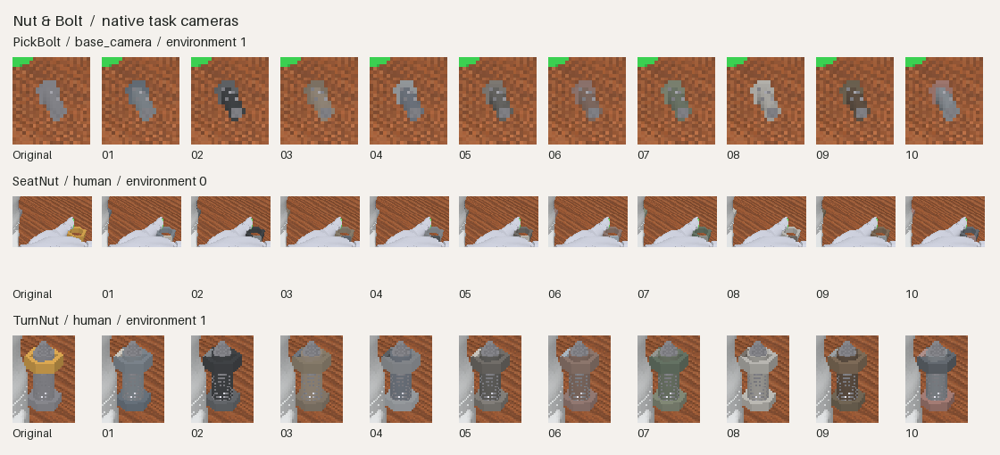

# Nut & Bolt 真实版

`nut_bolt_appearance` 沿用 `original` 和 `variant_1` 至 `variant_10`。十套候选采用常见五金的镀锌、发黑、拉丝不锈钢、磷化、铜闪镀、陶瓷干膜和抛光等表面处理。低饱和底色配合金属度、粗糙度和轴身／头部明暗变化，螺母参照面模拟抛光、检验涂层或扭矩漆。

[螺栓 catalog](../../assets/appearance/objects/nut_bolt/bolt/variants/v1/catalog.json)与[螺母 catalog](../../assets/appearance/objects/nut_bolt/nut/variants/v1/catalog.json)记录全部材质参数。候选用已有的轴身、头部和螺母参照面分区呈现饰面。锥尖、螺纹等功能面沿用原材质。两个螺母阶段共享外观选择并沿用原生阶段切换。几何、碰撞、物理、相机与任务判定沿用原任务。

## 任务相机对照

图中各行使用同一原生相机和同一环境，对原始帧做相同裁剪再放大。SeatNut 图示使用遮挡较少的 human 相机区域。正式逐对区分度以 wrist camera 为见证。

Windows 双环境 CUDA 从提交 `55d01179c9e1c56285f6e45af780793709e0042d` 捕获。PickBolt 的两环境逐对比较最小值从首次通过的 17 提高到 29 像素。蓝锌／石板灰干膜、黄锌／滚磨青铜以及磷化／石板灰三组经轴身明暗、头部色泽和粗糙度重新拉开。各方案恢复原版、双向局部 reset 的未选环境 RGB 隔离以及 SeatNut 的阶段切换通过原任务检查。

| 短任务 | 正式见证相机 | 两环境逐对比较 | 最少差异像素（RGB 任一通道差值 ≥ 8） |
| --- | --- | ---: | ---: |
| PickBolt | base camera | 110 | 29 |
| SeatNut | wrist camera | 110 | 48 |
| TurnNut | human | 110 | 390 |

[Windows 复算记录](../../assets/appearance/objects/nut_bolt/previews/realistic/windows_cuda_review.json)包含实际捕获提交、相机、PNG 数量和回执摘要。

Windows 原生 PhysX CPU 也通过三个短任务的接口与 39 组动态回归。对照包括关闭外观、原版及十套候选。逐值复算 2,379 份状态快照，共覆盖 2,340 个控制步和 46,800 个物理子步。[CPU 复算记录](../../assets/appearance/objects/nut_bolt/previews/realistic/windows_cpu_review.json)

## 复现

从仓库根运行 `python -B tools/variation/check_nut_bolt_appearance.py --static` 和 `python -B -m unittest discover -s tests -p 'test_nut*.py'`。原生环境按 [Nut 私有 SDK 与三短任务命令](NUT_BOLT_EXPANSION.md#验证命令)加载。双环境用 PickBolt seed 7、SeatNut seed 1 及 TurnNut seed 26。各次验收使用新输出目录。
