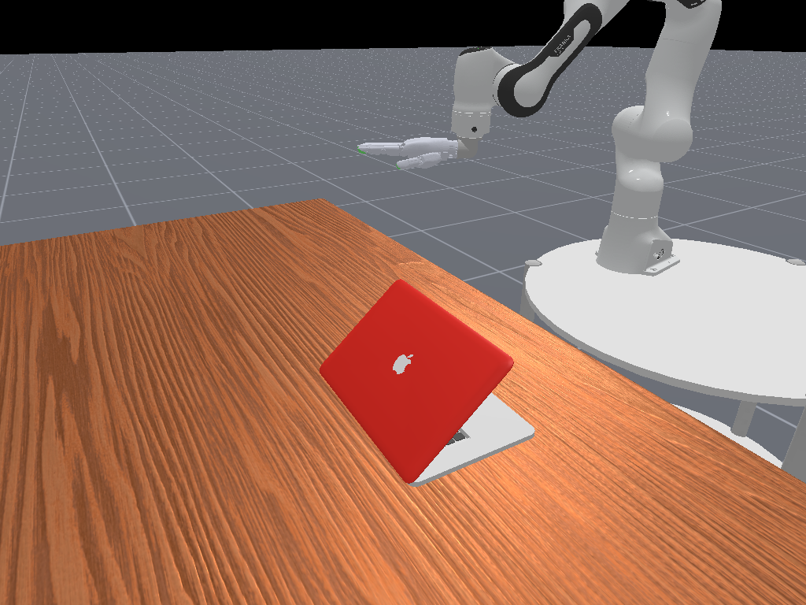
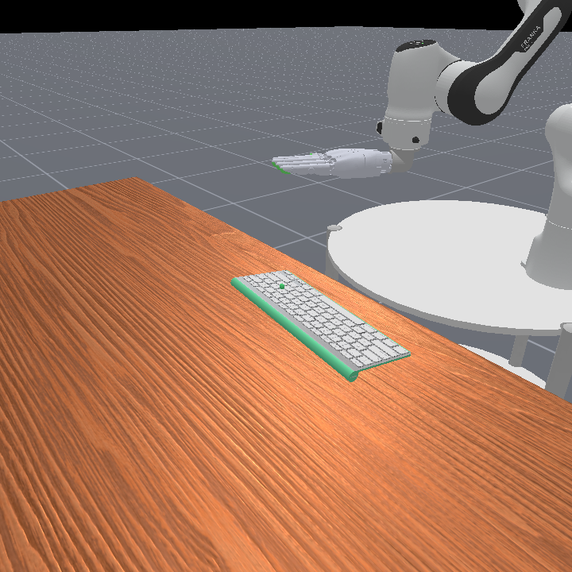
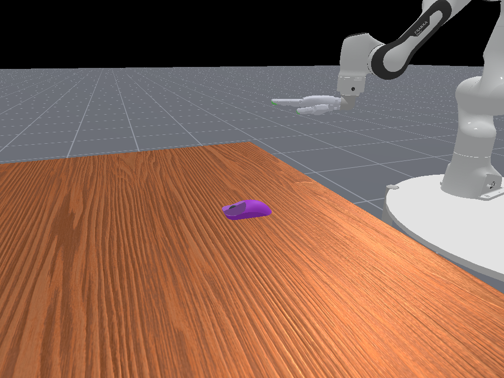
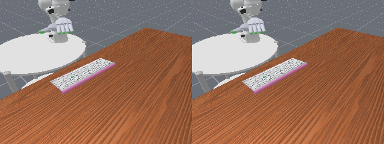
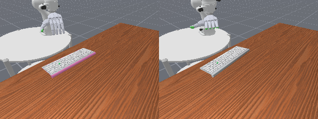

# Office Desk 外观

OpenLaptop、TypeKeys 和 ClickMouse 各支持 original 加十套候选，默认关闭外观。原有两套候选保留，三项共同追加 `variant_3` 至 `variant_10`。

## 选择与记录

各对象 catalog 保存材质参数，设备运行索引保存公开 ID 到材质方案的映射。下表每列标出实际配置键和材质角色，每格依次给出公开 `scheme_id`、材质方案和原生展示相机实景链接。 [笔记本 catalog](../../assets/appearance/objects/office_desk/laptop/catalog.json) · [键盘 catalog](../../assets/appearance/objects/office_desk/keyboard/catalog.json) · [鼠标 catalog](../../tasks/assets/variation/office_desk/mouse_101408/v1/catalog.json) · [设备运行索引](../../tasks/assets/variation/office_desk/devices/v1/catalog.json)

| 饰面 | OpenLaptop · `office_devices_appearance` · `bezel` | TypeKeys · `office_devices_appearance` · `shell` 与 `shell_strip` | ClickMouse · `mouse_appearance` · `shell`、`buttons`、`wheel` |
|---|---|---|---|
| 原版 | `original` → [原生材质](evidence/office_desk_expansion_v1/OpenLaptop/original_human_env0.png) | `original` → [原生材质](evidence/office_desk_expansion_v1/TypeKeys/original_human_env0.png) | `original` → [原生材质](evidence/office_desk_expansion_v1/ClickMouse/original_human_env0.png) |
| 候选 1 | `variant_1` → [`terracotta_matte`](evidence/office_desk_expansion_v1/OpenLaptop/variant_1_human_env0.png) | `variant_1` → [`ochre_matte`](evidence/office_desk_expansion_v1/TypeKeys/variant_1_human_env0.png) | `ivory_matte` → [`ivory_matte`](evidence/office_desk_expansion_v1/ClickMouse/ivory_matte_human_env0.png) |
| 候选 2 | `variant_2` → [`petrol_satin`](evidence/office_desk_expansion_v1/OpenLaptop/variant_2_human_env0.png) | `variant_2` → [`indigo_satin`](evidence/office_desk_expansion_v1/TypeKeys/variant_2_human_env0.png) | `navy_satin` → [`navy_satin`](evidence/office_desk_expansion_v1/ClickMouse/navy_satin_human_env0.png) |
| 朱红 | `variant_3` → [`variant_3`](evidence/office_desk_expansion_v1/OpenLaptop/variant_3_human_env0.png) | `variant_3` → [`variant_3`](evidence/office_desk_expansion_v1/TypeKeys/variant_3_human_env0.png) | `variant_3` → [`variant_3`](evidence/office_desk_expansion_v1/ClickMouse/variant_3_human_env0.png) |
| 柠檬黄 | `variant_4` → [`variant_4`](evidence/office_desk_expansion_v1/OpenLaptop/variant_4_human_env0.png) | `variant_4` → [`variant_4`](evidence/office_desk_expansion_v1/TypeKeys/variant_4_human_env0.png) | `variant_4` → [`variant_4`](evidence/office_desk_expansion_v1/ClickMouse/variant_4_human_env0.png) |
| 薄荷绿 | `variant_5` → [`variant_5`](evidence/office_desk_expansion_v1/OpenLaptop/variant_5_human_env0.png) | `variant_5` → [`variant_5`](evidence/office_desk_expansion_v1/TypeKeys/variant_5_human_env0.png) | `variant_5` → [`variant_5`](evidence/office_desk_expansion_v1/ClickMouse/variant_5_human_env0.png) |
| 松绿 | `variant_6` → [`variant_6`](evidence/office_desk_expansion_v1/OpenLaptop/variant_6_human_env0.png) | `variant_6` → [`variant_6`](evidence/office_desk_expansion_v1/TypeKeys/variant_6_human_env0.png) | `variant_6` → [`variant_6`](evidence/office_desk_expansion_v1/ClickMouse/variant_6_human_env0.png) |
| 钴蓝 | `variant_7` → [`variant_7`](evidence/office_desk_expansion_v1/OpenLaptop/variant_7_human_env0.png) | `variant_7` → [`variant_7`](evidence/office_desk_expansion_v1/TypeKeys/variant_7_human_env0.png) | `variant_7` → [`variant_7`](evidence/office_desk_expansion_v1/ClickMouse/variant_7_human_env0.png) |
| 紫罗兰 | `variant_8` → [`variant_8`](evidence/office_desk_expansion_v1/OpenLaptop/variant_8_human_env0.png) | `variant_8` → [`variant_8`](evidence/office_desk_expansion_v1/TypeKeys/variant_8_human_env0.png) | `variant_8` → [`variant_8`](evidence/office_desk_expansion_v1/ClickMouse/variant_8_human_env0.png) |
| 玫瑰粉 | `variant_9` → [`variant_9`](evidence/office_desk_expansion_v1/OpenLaptop/variant_9_human_env0.png) | `variant_9` → [`variant_9`](evidence/office_desk_expansion_v1/TypeKeys/variant_9_human_env0.png) | `variant_9` → [`variant_9`](evidence/office_desk_expansion_v1/ClickMouse/variant_9_human_env0.png) |
| 石墨灰（笔记本）／瓷白（键盘、鼠标） | `variant_10` → `variant_10`（[历史银灰原图](evidence/office_desk_expansion_v1/OpenLaptop/variant_10_human_env0.png)） | `variant_10` → [`variant_10`](evidence/office_desk_expansion_v1/TypeKeys/variant_10_human_env0.png) | `variant_10` → [`variant_10`](evidence/office_desk_expansion_v1/ClickMouse/variant_10_human_env0.png) |

[设备示例](../../examples/variation/office_desk/devices/) · [鼠标示例](../../examples/variation/office_desk/mouse_101408/)

```python
import gymnasium as gym
import tasks
import torch

env = gym.make("OfficeDeskOpenLaptop-Sharpa-v1", num_envs=2,
    sim_backend="physx_cuda", obs_mode="rgb", render_mode="rgb_array",
    office_devices_appearance={"enabled": True, "scheme_id": "variant_3",
        "per_env": {"1": {"scheme_id": "variant_8"}}})
env.reset(seed=7)
env.reset(options={"env_idx": torch.tensor([1], device=env.unwrapped.device),
    "office_devices_appearance": {"scheme_id": "original"}})
```

`random_choice` 从非空 `scheme_ids` 抽样。覆盖顺序为构造公共 → 构造 `per_env` → reset 公共 → reset `per_env`。`enabled` 和外观 `seed` 仅在构造的公共配置中设置。`per_env` 使用规范的环境编号字符串和字典值。传入的 `env_idx` 须严格递增，局部 reset 省略 reset `seed`。状态恢复沿用原生状态恢复路径，同次调用禁止传入外观覆盖。

启用外观时，首次初始化及普通 reset 均在进入原生 reset 前校验每个选中环境的有效模式及方案。随机模式校验完整候选列表。遇到错误时直接报错，原生 reset、任务随机流、状态和材质写入尚未开始。外观关闭时仍校验覆盖格式，任务直接沿用原生外观。

每个环境有独立的私有材质、外观随机流和回合计数。显式选择和渲染均不抽样。回合记录包含 `env_idx`、`episode_index`、`scheme_id` 和 `catalog_version`。

## 原生槽与保护

[笔记本](../../assets/appearance/objects/office_desk/laptop/) 只修改屏框背壳 `new-2.obj/material-0` 的颜色、粗糙度和金属度，保留屏幕、标识与其他槽。[键盘](../../assets/appearance/objects/office_desk/keyboard/) 修改三个无纹理外沿槽，并从原纹理壳体的 502 面中分出 76 个无字壳带面。每个环境为壳带预先绑定原图的私有副本，切换时只上传像素：候选使用目录色，`original` 恢复逐字节相同的原生像素。其余 426 面及 77 个可动键保留原 PBR 和原纹理。目标键映射 `P39/A24/I41/R45/ENTER35` 不变。

[UV 证明](../../assets/appearance/objects/office_desk/keyboard/key_uv_protection.json) 检查连续三角面与双线性纹理采样是否进入键面及其 8 texel 边界，可从原资产重新计算。重新分组保留原三角面、顶点、法线、UV、绕序和变换。双环境下，绿色视觉标记在各自目标键上更新。几何、碰撞、质量、关节及任务成功条件保持原定义。

## 复现与验收边界

先准备 SIPAIR/DexArena 原模型 revision `b197a198fe50f41d70f563cfa7c88d3cc9f528b6` 与工具要求的 [私有 SDK](../../tools/variation/sapien_sdk/README.md)。ClickMouse 另需 `coacd==1.0.14`、`trimesh` 和原模型随附的五份碰撞缓存。复核证据哈希时使用 LF 工作树（Windows 可用 `git -c core.autocrlf=false clone`）。

```powershell
python -B tools/variation/check_office_devices.py --require-assets
python -B -m unittest discover -s tests -p test_office_devices_appearance.py
python -B tools/variation/check_static.py
python -B tools/variation/check_appearance_archive.py
$batch = 'outputs/office_expansion_new'
& ./tools/variation/run_office_expansion.ps1 -Batch $batch -Python $python `
    -SapienRoot $sdk -Artifact $receipt -PhysxGpuDir $physx
& $python -B tools/variation/export_office_expansion.py --batch $batch `
    --artifact $receipt --output outputs/office_expansion_review
```

脚本逐项串行执行并保存命令、退出码和输出。在协调者管理的共享 GPU 上追加 `-GpuLock $gpuLock`，指向其锁脚本。使用新批次目录。精简导出器读取该批次，逐项复算原始 PNG、PT 和纹理数组。`two_env` 只调整三项 GPU 接触缓冲容量。实际 SimConfig 写入运行报告。选中状态读回使用 `atol=2e-6, rtol=0`，原版恢复及未选环境 RGB 按逐值相等检查。

固定可辨性沿用 PR #16 的原生相机和种子 7。每候选均在两环境的任务传感器画面产生变化。另在每环境的原生展示相机比较 55 对方案，每对至少 0.1% 的像素有一个 RGB 通道变化超过 8 个色级。键盘额外核对私有纹理句柄、首次及重复帧、绿色目标提示与双向局部 reset。

| 验收项 | 结果 |
|---|---|
| 当前源码的静态检查 | 源资产、任务 AST、76 面 UV 证明及仓库静态、档案检查通过 |
| 当前源码的公开 reset | CPU 替身对三个任务逐个验证八套新 ID 合法转发。每个 ID 的末环境错字与含坏值随机列表均在原生 reset 前被拒绝 |
| 历史 CPU 接口与动态 | 真实接口覆盖各 11 种外观及候选恢复。每任务动态 13 组，每组 60 步。共 2,340 控制步、46,800 物理子步，逐步状态、控制目标、奖励与判定差均为 0 |
| 历史 Windows 私有 SAPIEN v5 双环境 CUDA | 126 次选中状态读回、6 控制步、120 物理子步。双向状态、控制器、随机流、记录及 RGB 隔离通过。每任务十次候选恢复原版，所有原生相机 RGB 差 0 |
| 历史固定相机可辨性 | 三任务各 55 对、每对两环境。变化超过 8 色级像素比例的最小值分别为 OpenLaptop 2.878%、TypeKeys 0.502%、ClickMouse 0.254% |

历史成功路径使用以 PR #16 `66c7a1569d92487ab918df31014e0d86a70f29c2` 为基础的扩容采集，输入和 SDK 由摘要标识。归档含 33 张固定外观图、12 张局部 reset 对照原图及各自哈希。原版和原有两候选的展示图与 PR #16 逐像素相等。 [扩容运行摘要](evidence/office_desk_expansion_v1/summary.json) · [扩容实景](evidence/office_desk_expansion_v1/) · [PR #16 原始归档](../../assets/appearance/objects/office_desk/previews/runtime/)

正文推荐下列五张图。

| OpenLaptop · 朱红 | TypeKeys · 薄荷绿 | ClickMouse · 紫罗兰 |
|---|---|---|
|  |  |  |

| TypeKeys 重置 env1 时，env0 前后不变 | TypeKeys 重置 env0 时，env0 恢复原版 |
|---|---|
|  |  |

验收范围为 Windows 私有 SAPIEN v5 的三项短任务。Long、Linux、segmentation、完整机器人任务成功和本轮独立模型预览未验收。
