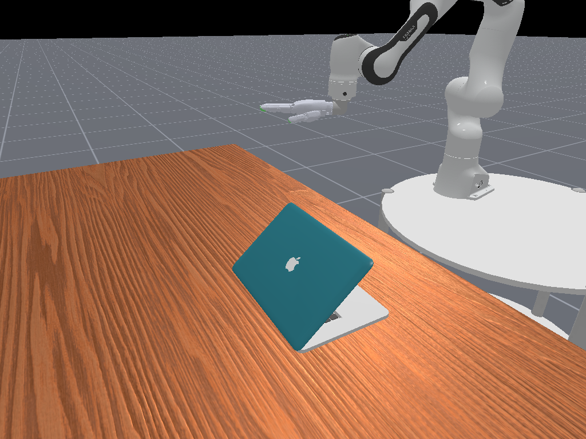
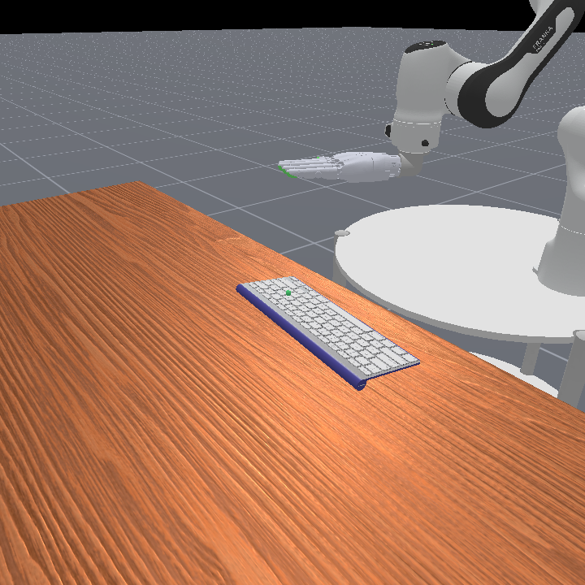

# Office Desk 外观

OpenLaptop 和 TypeKeys 各新增两套外观。ClickMouse 沿用现有两套方案，并与前两项一起检查局部 reset 的任务随机流、控制器和计数。三项默认关闭外观。

## 选择与记录

设备参数唯一来源为 [laptop catalog](../../assets/appearance/objects/office_desk/laptop/catalog.json) 和 [keyboard catalog](../../assets/appearance/objects/office_desk/keyboard/catalog.json)。[运行索引](../../tasks/assets/variation/office_desk/devices/v1/catalog.json) 只映射方案，不复制参数。

| 任务 | original | variant_1 | variant_2 |
|---|---|---|---|
| OpenLaptop | 捕获原版 | terracotta_matte | petrol_satin |
| TypeKeys | 捕获原版 | ochre_matte | indigo_satin |
| ClickMouse | 捕获原版 | ivory_matte | navy_satin |

前两项使用 `office_devices_appearance` 和表中列头的方案 ID；ClickMouse 使用 `mouse_appearance` 和表中对应的方案名。见 [设备示例](../../examples/variation/office_desk/devices/) 和 [鼠标示例](../../examples/variation/office_desk/mouse_101408/)。

```python
import gymnasium as gym
import tasks
import torch

env = gym.make("OfficeDeskOpenLaptop-Sharpa-v1", num_envs=2,
    sim_backend="physx_cuda", obs_mode="rgb", render_mode="rgb_array",
    office_devices_appearance={"enabled": True, "scheme_id": "variant_1",
        "per_env": {"1": {"scheme_id": "variant_2"}}})
env.reset(seed=7)
env.reset(options={"env_idx": torch.tensor([1], device=env.unwrapped.device),
    "office_devices_appearance": {"scheme_id": "original"}})
```

`random_choice` 从非空 `scheme_ids` 抽样。覆盖顺序为构造公共 → 构造 `per_env` → reset 公共 → reset `per_env`。`enabled` 和外观 `seed` 仅在构造的公共配置中设置。`per_env` 使用规范的环境编号字符串和字典值。传入的 `env_idx` 须严格递增，局部 reset 省略 reset `seed`。状态恢复沿用原生状态恢复路径，同次调用禁止传入外观覆盖。

启用外观时，首次初始化及普通 reset 均在进入原生 reset 前校验每个选中环境的有效模式及方案。随机模式校验完整候选列表。遇到错误时直接报错，原生 reset、任务随机流、状态和材质写入尚未开始。外观关闭时仍校验覆盖格式，任务直接沿用原生外观。

每个环境有独立的私有材质、外观随机流和回合计数。显式选择和渲染均不抽样。回合记录包含 `env_idx`、`episode_index`、`scheme_id` 和 `catalog_version`。

## 原生槽与保护

[笔记本](../../assets/appearance/objects/office_desk/laptop/) 只修改屏框背壳 `new-2.obj/material-0` 的颜色、粗糙度和金属度，保留屏幕、标识与其他槽。[键盘](../../assets/appearance/objects/office_desk/keyboard/) 修改三个无纹理外沿槽，并从原纹理壳体的 502 面中分出 76 个无字壳带面。每个环境为壳带预先绑定原图的私有副本，切换时只上传像素：候选使用目录色，`original` 恢复逐字节相同的原生像素。其余 426 面及 77 个可动键保留原 PBR 和原纹理。目标键映射 `P39/A24/I41/R45/ENTER35` 不变。

[UV 证明](../../assets/appearance/objects/office_desk/keyboard/key_uv_protection.json) 检查连续三角面与双线性纹理采样是否进入键面及其 8 texel 边界，可从原资产重新计算。重新分组保留原三角面、顶点、法线、UV、绕序和变换。双环境下，绿色视觉标记在各自目标键上更新。几何、碰撞、质量、关节及任务成功条件保持原定义。

## 复现与验收边界

先准备 SIPAIR/DexArena 原模型 revision `b197a198fe50f41d70f563cfa7c88d3cc9f528b6` 与工具要求的 [私有 SDK](../../tools/variation/sapien_sdk/README.md)。ClickMouse 另需 `coacd==1.0.14`、`trimesh` 和原模型随附的五份碰撞缓存。复核证据哈希时使用 LF 工作树（Windows 可用 `git -c core.autocrlf=false clone`）。

```powershell
python -B tools/variation/check_office_devices.py --require-assets
python -B -m unittest discover -s tests -p test_office_devices_appearance.py
python -B tools/variation/check_static.py
python -B tools/variation/check_appearance_archive.py
python -B tools/variation/check_office_devices_dynamics.py --steps 60 --seed 7 `
  --sapien-root $sdk --artifact $receipt --physx-gpu-dir $physx --output outputs/office_cpu
python -B tools/variation/sapien_sdk/run_task_check.py --repo-root . `
  --checker tools/variation/check_office_devices_runtime.py `
  --sapien-root $sdk --artifact $receipt --physx-gpu-dir $physx --output outputs/office_cuda `
  --approved-runtime --sim-backend physx_cuda --experimental-windows-cuda --gpu-memory-profile two_env
```

输出目录须为新目录。CPU 接口检查使用同一启动器，指定 `--sim-backend physx_cpu` 并省略 CUDA 专用参数。`two_env` 只调整 GPU 接触缓冲容量；实际 SimConfig 完整写入报告。选中状态读回容差为 `atol=2e-6, rtol=0`，RGB 比较逐值精确。

| 验收项 | 结果 |
|---|---|
| 当前源码的公开 reset | CPU 替身覆盖三项真实入口。合法方案按覆盖顺序转发，末项无效方案和混入坏值的随机候选在原生调用前被拒绝 |
| 当前源码的静态检查 | 源资产、完整任务 AST、76 面 UV 证明及仓库静态、档案检查通过 |
| 历史 CPU 接口与动态 | 三项真实接口有原版和候选记录。关闭外观、重复基线、启用原版和两候选，每任务每设置 60 步，共 900 控制步、18,000 物理子步。逐步状态、控制目标、奖励与判定差均为 0 |
| 历史 Windows 私有 SAPIEN v5 双环境 CUDA | 三项共 78 次选中状态读回、6 控制步、120 物理子步。双向状态、控制器、随机流、记录及 RGB 隔离通过，原版恢复 RGB 差 0 |

运行摘要记录历史采集的原始源码、资产和 SDK 身份。其 CPU、CUDA 和图像记录用于成功路径验收。完整实景对照含原版、两候选与双向局部 reset 前后图。 [运行摘要](../../assets/appearance/objects/office_desk/previews/runtime/summary.json) · [实景对照](../../assets/appearance/objects/office_desk/previews/runtime/)

| OpenLaptop · petrol_satin | TypeKeys · indigo_satin | ClickMouse · navy_satin |
|---|---|---|
|  |  |  |

Long 未接入；Linux、segmentation 与完整机器人任务成功未验收。
