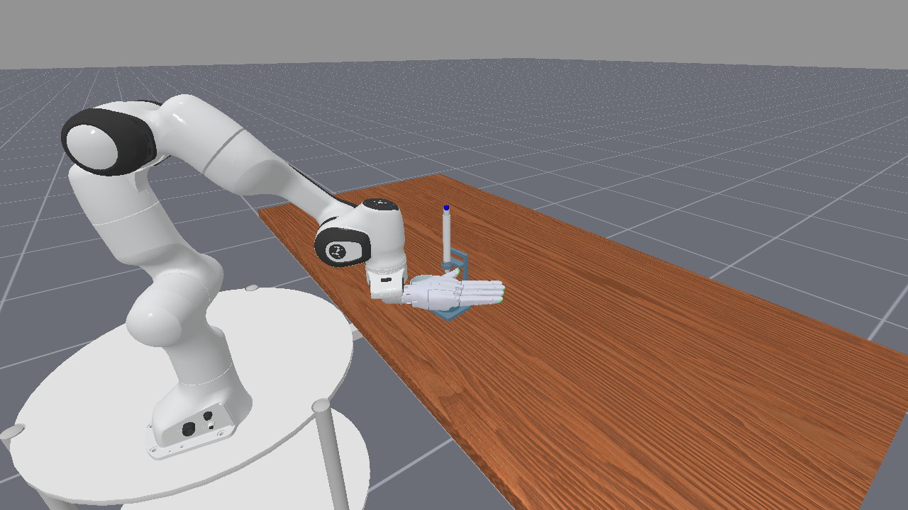
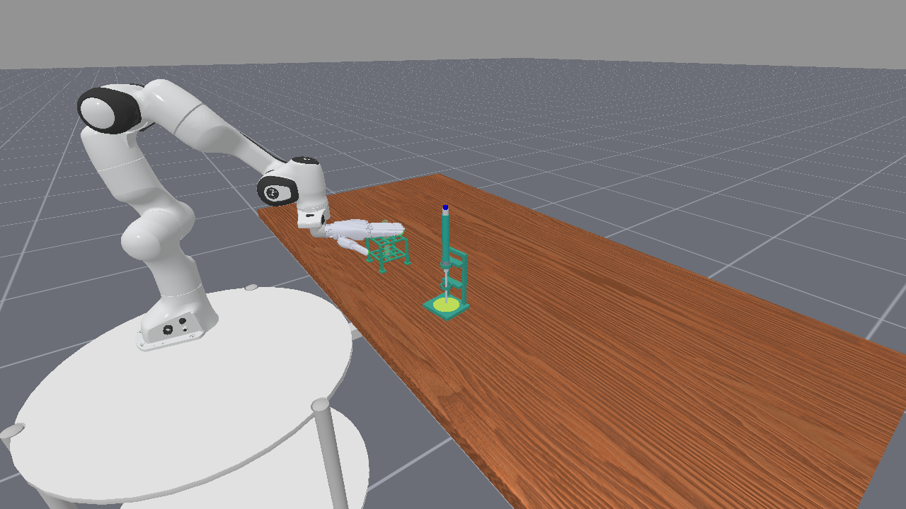

# Pipette Transfer 外观

AspirateLiquid 与 DispenseLiquid 的六个可见对象支持 original 加十套候选。真实版沿用 `jade`、`coral`、`variant_3` 至 `variant_10` 的方案 ID，按注塑外壳、玻璃、喷涂底板、可更换导向件和防滑脚分别选材。玻璃沿用各角色原有候选 alpha，杯沿与管沿使用更深的同系色体现厚边。方案参数由[对象 catalog](../../assets/appearance/objects/pipette_transfer/catalog.json)定义，[运行索引](../../tasks/assets/variation/pipette_transfer/v1/catalog.json)列出方案、任务和绑定。

| ID | 仪器与容器配色 |
|---|---|
| `jade` | 灰绿注塑件与淡绿玻璃 |
| `coral` | 陶土色 ABS 外壳与淡玫瑰玻璃 |
| `variant_3` | 象牙色外壳、深暖灰导环与无色玻璃 |
| `variant_4` | 石板蓝塑料与蓝灰玻璃 |
| `variant_5` | 炭灰聚合物与烟灰玻璃 |
| `variant_6` | 冷灰外壳、喷砂合金立柱、银灰导环与冷蓝玻璃 |
| `variant_7` | 卡其树脂与棕琥珀玻璃 |
| `variant_8` | 灰青外壳、喷砂合金立柱与淡青玻璃 |
| `variant_9` | 梅灰聚合物与淡紫玻璃 |
| `variant_10` | 麦色树脂、浅色导环与浅琥珀玻璃 |

| 对象 | 正式绑定与保护 |
|---|---|
| 移液器 | 三 link 原生 articulation；仅 base.visual[0] 主体可变，其余五视觉完整 PBR、蓝柱塞及关节保留 |
| 样品杯 | 按壁、底、沿绑定；候选只改 RGB／受控 alpha，其余光学参数保留 |
| 试管 | 按壁、球底、沿绑定；动态刚体、质量和碰撞保留 |
| 试管架 | 原有上下格栅、立柱、脚垫独立配色 |
| 支架／吸头杯 | 同一 Actor；底板、立柱、导环和 stand.visual[4] 吸头承托盘独立配色 |

liquid_state 无视觉。所有方案保持机器人、位置规则、几何、碰撞、质量、关节、物理参数与成功判定。原资产、许可与文件身份见[资产审计](../../assets/appearance/objects/pipette_transfer/pipette/asset_audit.json)。支架底板将[原创灰阶标识](../../assets/appearance/objects/pipette_transfer/pipette_stand/base-plate-mark.png)与各套底板色烘焙成 sRGB RGB 贴图，沿用原生盒体 UV。[烘焙工具](../../tools/variation/build_pipette_stand_textures.py)按 catalog 校验实际像素。移液器及其它圆柱保留原生材质绑定。

**配置与生命周期**

```python
import gymnasium as gym
import tasks

env = gym.make(
    "PipetteTransferAspirateLiquid-Sharpa-v1",
    pipette_appearance={"enabled": True, "scheme_id": "jade", "seed": 71},
    pipette_rendering={"enabled": True},
)
obs, info = env.reset(seed=7)
obs, info = env.reset(options={"pipette_appearance": {"scheme_id": "original"}})
records = env.unwrapped._pipette_appearance.records
```

省略外观配置或关闭时，不创建外观材质、随机流或记录器。启用时在建场前按环境克隆材质，保留组件内部原有共享拓扑，捕获完整原生 PBR；原任务及短任务阶段初始化完成后统一应用方案。original 准确恢复捕获值，render 不重抽方案。

覆盖顺序为构造公共 → 构造 `per_env` → reset 公共 → reset `per_env`。`per_env` 使用实际环境编号的标准字符串键（如 `"0"`）和字典值。外观启用时，公开 `reset` 在进入父类前校验所有选中环境的有效显式 ID 或完整 `random_choice` 列表。无效方案在任务初始化、抽样、物理写入和材质修改前即被拒绝。外观关闭时，合法形状的 reset 覆盖不会启用外观。

外观 RNG 按环境独立，显式方案不抽样。记录包含 `env_idx`、`episode_index`、`scheme_id`、`catalog_version`。`enabled` 和外观 `seed` 在构造时设置。局部 reset 隔离任务随机流、控制器缓冲及评价锁存状态。

显式 `env_idx` 必须严格递增，支持整数序列或一维整数张量。reset 使用当前设备的 long 索引，保持调用方参数不变。任务 seed 仅可随全环境 reset 设置。`reset_to_env_states` 走原生恢复路径并保留当前外观，组合 `pipette_appearance` 覆盖会遭拒绝。

[关闭示例](../../examples/variation/pipette_transfer/default.json) · [固定示例](../../examples/variation/pipette_transfer/fixed.json) · [随机示例](../../examples/variation/pipette_transfer/random.json)

**显式渲染配置**

`pipette_rendering` 默认关闭，保留原生 minimal 默认相机路径。候选要求显式启用经核定的修复 default 管线：按每环境真实 tip_cup render-id 修复目标片元深度，并在建场、GPU 批处理前将 sample_cup 固定到透明 gbuffer pass。杯体 PBR 及底盘原 alpha 保留，其余对象不改 pass；reset 不改 shading_mode、Scene version、相机或 images。

任务与模型预览仅接受已核定的 SAPIEN 3.0.3 default shader 文件对。LF 和 CRLF 各有一组精确字节哈希。启用修复时，先核对整个文件对，再应用同一片元补丁。

native_off、original 与候选的验收统一使用上述“修复 default shaders＋sample cup 固定透明 pass”配置。original 指该配置下的原生 PBR 及精确像素恢复；不声称与 stock default 或 minimal 的 RGB 相同。私有 shader 包按来源／补丁身份缓存，逐环境绑定实际 ID，不修改安装目录、顶点或世界位置。材质与深度参数读取唯一 catalog。

**Windows 历史扩容档案**

[扩容摘要](../../assets/appearance/objects/pipette_transfer/previews/runtime_expansion_v2/summary.json)与[全部 132 张固定原图的索引](../../assets/appearance/objects/pipette_transfer/previews/runtime_expansion_v2/fixed_frames.json)记录 Windows 两短任务的实测结果。每任务各 11 张可直接查看的原生 human 视角 PNG 分别存放在 [AspirateLiquid](../../assets/appearance/objects/pipette_transfer/previews/runtime_expansion_v2/AspirateLiquid) 和 [DispenseLiquid](../../assets/appearance/objects/pipette_transfer/previews/runtime_expansion_v2/DispenseLiquid)。

CPU 公开入口合同逐项覆盖所有候选的合法转发与最后一个环境拼错方案时的零副作用拒绝。下表保留该批 Windows 扩容原始记录中的采集身份，样品杯透明 pass 与承托盘深度偏置证据均来自显式开启 `pipette_rendering` 的场景。

| 验收 | 结果 |
|---|---|
| 正式 CPU 接口与动态 | 两任务全部方案通过。每任务两次原生关闭和十一套固定方案各 60 步，共 1,560 控制步、31,200 物理子步，逐步状态差为零 |
| 标准双环境 CUDA | 130 次选中状态读回，20 控制步、400 物理子步。双向局部 reset 的未选环境状态和三相机 RGB 保持一致，两任务每个候选在固定初态均恢复 original RGB 差 0 |
| 逐对象可辨性 | 两任务合计 990 组相机遮罩对照通过。最弱的一组仍有 92 个目标像素的最大通道差达到 8 |
| 原生模型和光学 | 六个独立模型恢复差 0。两组玻璃条纹对照覆盖十候选。任务深度共 56 次构造、112 组对照，Aspirate 有 5 组无共同可见承托盘像素 |

精选五张实景。[Aspirate original](../../assets/appearance/objects/pipette_transfer/previews/runtime_expansion_v2/AspirateLiquid/original_human_env0.png) · [Aspirate variant_8](../../assets/appearance/objects/pipette_transfer/previews/runtime_expansion_v2/AspirateLiquid/variant_8_human_env0.png) · [Dispense variant_9](../../assets/appearance/objects/pipette_transfer/previews/runtime_expansion_v2/DispenseLiquid/variant_9_human_env0.png) · [局部 reset 选中 env1](../../assets/appearance/objects/pipette_transfer/previews/runtime_expansion_v2/AspirateLiquid/local_variant_3_variant_4_1_base_camera_env1.png) · [同轮未选 env0](../../assets/appearance/objects/pipette_transfer/previews/runtime_expansion_v2/AspirateLiquid/local_variant_3_variant_4_1_base_camera_env0.png)。

**本地扩容发布档案**

Windows 受控 SAPIEN `3.0.3+dexarena.gpu1.wininterop5` 上重新运行两个短任务。最新[双环境 CUDA 复核](evidence/pipette_transfer/expansion/windows-gpu-review.json)记录 130 次选中状态读回、20 控制步、400 物理子步、990 组逐对象配色对照及 32 个新增方案局部 reset 方向。候选均恢复同初态 original，未选环境的三台相机 RGB 保持一致。历史扩容归档中 24 张公开 PNG 和 PR #14 的六张固定外观在本机重现，PNG 字节逐张一致。

Pipette CPU 接口合同测试通过。[CPU 动态复核](evidence/pipette_transfer/expansion/windows-cpu-dynamics.json)记录两任务 26 轮、1,560 控制步与 31,200 物理子步。所有固定外观逐状态复现 native_off，逐帧复算已核对关节实际运动，并核对材质稳定记录。

**Server 3 扩容发布档案**

[AspirateLiquid 与 DispenseLiquid 的 Linux 运行证据](evidence/pipette_transfer/expansion/README.md)来自作业 `123819`。采集提交与发布运行提交的 Pipette 源码、运行 catalog、共享 reset 和验证工具路径逐个核对一致。

| 检查 | Linux 实测 |
|---|---|
| 标准双环境 CUDA | 130 次选中状态读回、20 控制步、400 物理子步 |
| 局部 reset、original 恢复 | 新增方案 32 个局部 reset 方向，未选状态和原三相机 RGB 一致，同初态恢复 original 的 RGB 差为 0 |
| 可辨性 | 990 组逐对象配对全部通过，最低见证为 AspirateLiquid 样品杯的 92 个目标像素 |
| 光学深度 | 112 个原相机／环境对照，按目标片元在两次构造中共同可见的像素复核 |

Linux 使用 SDK 说明中的 wheel、artifact 和 PhysX 路径。下例采集 AspirateLiquid，DispenseLiquid 使用独立输出目录。对同一任务使用新目录，并增加 `--pipette-optical`，可运行任务深度补充检查。

```bash
python -B tools/variation/sapien_sdk/run_linux_check.py \
  --checker pipette --task AspirateLiquid --approved-runtime --two-env-memory \
  --wheel "$wheel" --artifact "$artifact" --physx-gpu-dir "$physx" \
  --output "$capture/linux_aspirate"
```

**PR #14 验收档案**

以下结果对应 original、jade、coral。见[正式运行摘要](../../assets/appearance/objects/pipette_transfer/previews/runtime/summary.json)和[实际任务相机补充检查](../../assets/appearance/objects/pipette_transfer/previews/runtime/rendering_probe_summary.json)。

| 检查 | 已验证范围 |
|---|---|
| 静态／CPU 合同 | 参数与保护角色、绑定、完整 original、原材质共享拓扑、配置覆盖、独立 RNG、非法请求原子性、局部 seed 拒绝；几何／判定／奖励／状态 AST 保持原定义 |
| 正式短任务接口 | 两任务关闭、original、两候选、随机复现、per_env／reset 覆盖及完整回合记录 |
| CPU 动态 | 每任务五设置各 60 步，共 600 control／12000 physics；native_repeat、original、两候选相对 native_off 的 61 个快照逐值精确一致，材质稳定 |
| 标准 CUDA 双环境 | 两任务共 46 次选中读回、4 control／80 physics；双向局部 reset 未选状态／控制器／随机流／记录精确不变，base、wrist、human 原相机 RGB 差 0，original 完整恢复 RGB 差 0 |
| 相机／深度补充 | 两布局 seed、七次毫米眼点变化、两种建批前深度设置，共 56 次构造、112 个 camera/env/view 对照；无显式控制步；目标外 RGB／depth 差 0，共同可见 tip 的 XYZ／Raw 不变，按记录 NDC 偏置变化 |

CUDA 使用显式 `two_env` GPU 缓冲容量配置；solver、contact、重力、休眠、频率、原相机尺寸与近远面保持任务定义。任何缓冲溢出、分配失败或 CPU 回退均失败。运行记录包含完整实际 SimConfig、源码／资产／外部 ManiSkill 文件闭包及私有 SDK 前后身份。

Aspirate 的部分原相机视图存在遮挡或无偏置时盘不可见，补充摘要逐项标记 visibility_limit；不对无共同像素处声称 XYZ 验证。结果限定记录的任务、seed、视距、相机和显式渲染配置。该首批采集限 Windows 短任务；本次扩容的 Linux 结果见上文。真实流体及完整机器人任务成功留待独立验证。

**正式任务实景**

AspirateLiquid：original、jade、coral。




DispenseLiquid：original、jade、coral。





**复现**

```powershell
python -B tools/variation/check_pipette_runtime.py --static --baseline origin/main
python -B tests/test_pipette_appearance.py
python -B tests/test_pipette_shader_sources.py
python -B tools/variation/check_static.py
python -B tools/variation/check_appearance_archive.py
```

按[SDK 说明](../../tools/variation/sapien_sdk/README.md)准备 runtime、artifact 与 PhysX 路径，使用[通用启动器](../../tools/variation/sapien_sdk/run_task_check.py)运行 `check_pipette_runtime.py --approved-runtime --sim-backend physx_cuda --experimental-windows-cuda --gpu-memory-profile two_env --task AspirateLiquid`，DispenseLiquid 另进程运行；输出目录必须全新。启动器在原生导入前保留系统 Vulkan loader，并前后核对加载路径和 SHA256。

CPU 使用 `check_pipette_dynamics.py --steps 60 --seed 7`，父进程传入 `--sapien-root --artifact --physx-gpu-dir`，每个 worker 独立核验 SDK。`check_pipette_rendering.py` 采集相机补充证据；`compact_pipette_rendering.py` 直接复核其 PNG／NPZ／PT。

[原 PR 证据导出器](../../tools/variation/compact_task_runtime.py) 用于原两候选的历史档案。静态校验以含首批实现的 main 为基线。运行证据记录实际 checkout、源码和资产 SHA、原生视角、布局 seed 7、`two_env` 缓冲配置和 Windows 私有 SAPIEN v5。

**扩容复现**

各命令在仓库根目录串行运行。准备审计过的原始 Pipette URDF，在 `$capture` 和 `$console` 下分别记录同名原始子目录与命令日志。以下为 AspirateLiquid 的 CUDA 采集，`$py` 是 Python 可执行文件。团队共用 GPU 时可由本机共享锁包装同一命令。

```powershell
$sdkArgs = @('--sapien-root', $runtime, '--artifact', $artifact, '--physx-gpu-dir', $physx)
$captureArgs = @('tools/variation/sapien_sdk/run_task_check.py', '--repo-root', '.',
    '--checker', 'tools/variation/check_pipette_runtime.py', '--output', "$capture/gpu_aspirate",
    '--approved-runtime', '--sim-backend', 'physx_cuda', '--experimental-windows-cuda',
    '--gpu-memory-profile', 'two_env', '--task', 'AspirateLiquid') + $sdkArgs
$monitorArgs = @('--output', "$console/gpu_aspirate", '--delta-mib', '1792', '--timeout-s', '1800',
    '--', $py, '-B') + $captureArgs
& $py -B tools/variation/monitor_pipette_expansion.py @monitorArgs
```

按下表替换 checker、运行参数和两个输出子目录。CPU 项将监测上限设为 `1024` MiB。

| 原始子目录 | checker 和参数 |
|---|---|
| `gpu_aspirate`、`gpu_dispense` | `check_pipette_runtime.py --approved-runtime --sim-backend physx_cuda --experimental-windows-cuda --gpu-memory-profile two_env --task <任务>` |
| `cpu_interface` | `check_pipette_runtime.py --approved-runtime --sim-backend physx_cpu` |
| `cpu_dynamics` | `check_pipette_dynamics.py --steps 60 --seed 7`，直接运行并传入三项私有 SDK 路径 |
| `probe_aspirate`、`probe_dispense` | `check_pipette_rendering.py --approved-runtime --sim-backend physx_cuda --experimental-windows-cuda --gpu-memory-profile two_env --task <任务>` |
| `model_<对象>` | `render_pipette_preview.py --render --verify-visuals --size 512 --objects <对象>`，六个对象各一进程 |

```powershell
python -B tools/variation/compact_pipette_expansion.py --captures $capture --consoles $console --sdk-artifact $artifact --output $archive
```

扩容复核从原始 PNG、任务分割、PT 状态和光学附件重算，保留原 PNG 字节。固定方案逐对象使用可编辑视觉片元的分割掩码做两两对照。每个环境须有一个原相机见证，对每对方案至少八个目标像素的最大通道差达到八个 RGB 级。每套恢复 original 和所有未选环境的 RGB 差均要求为零。条纹目标检查玻璃透视可读性，任务深度探针核验承托盘的目标片元偏置。
