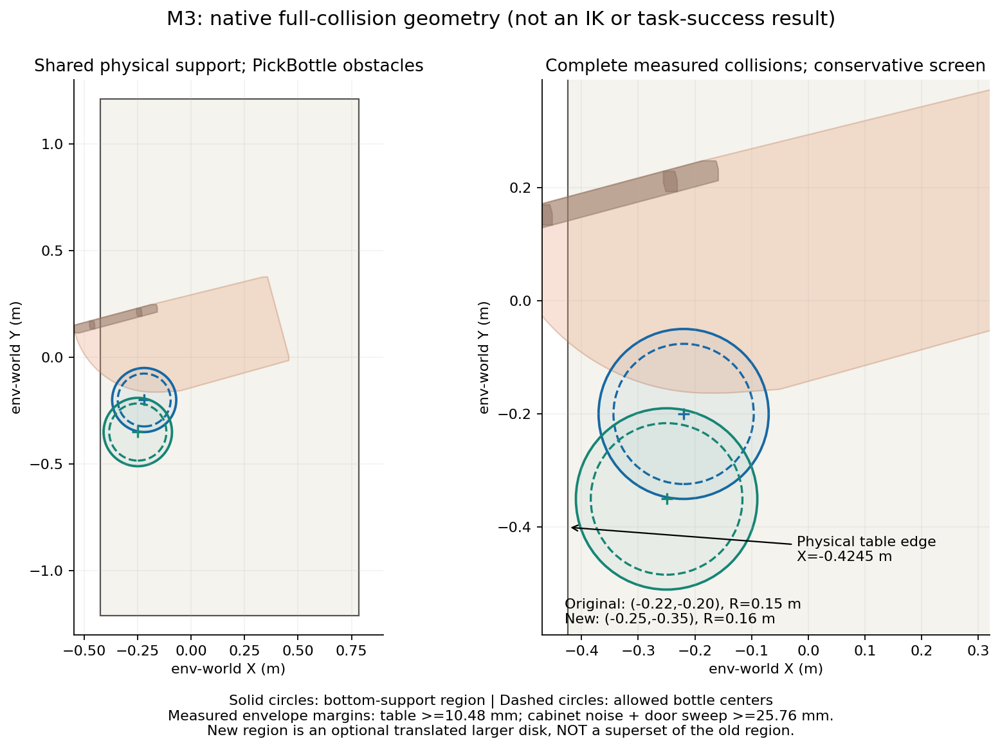
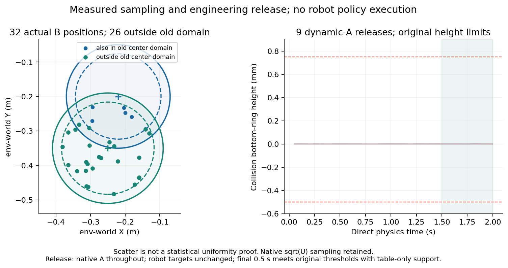
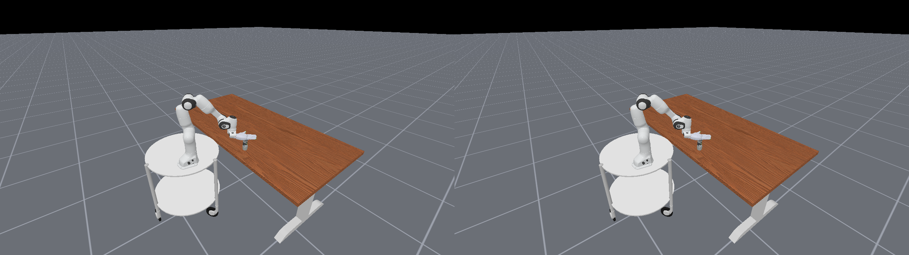
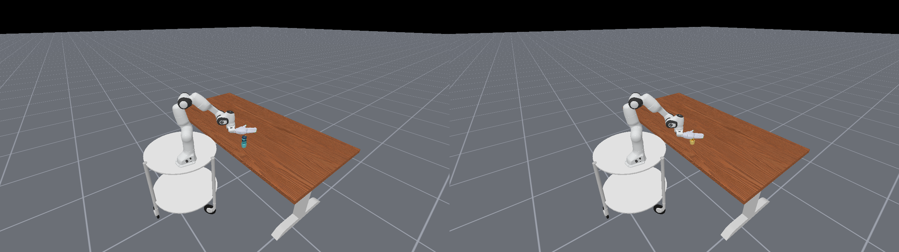

# M3桌面XY区域：本分支验证记录

本分支增加可选 `cabinet_pouring.bottle_table.xy_v2`，中心(−.25,−.35)m、R=.16m；原默认与原ID保持。仅修改现有适配器和必要配置／说明，不改父任务、子任务、成功条件、几何、物理、机器人、外观素材或渲染机制。

本次完成完整碰撞补测、2／4环境配置、9点动态释放及两个任务16环境验证。这里区分本次实测与M2继承证据；没有完整任务或RL成功结论。

## 完整碰撞与连续域筛查

本次读取实际安装中的518个瓶碰撞片段、盖实体碰撞、柜体／柜门全部39个碰撞片段及两任务原机器人逐link／shape几何。未用整机粗AABB断言碰撞，未用视觉代替缺失碰撞。测得底圈半径.026258624604m，与M1一致；瓶／盖组合平面包络半径.030277638m。

按完整瓶／盖包络与整个中心采样盘筛查，而不是只测9点：到物理桌边保守余量约10.48mm；柜体原XY噪声及门0…90°扫掠、插值位移界计入后，保守余量约25.76mm。两任务本次测得的原机器人初态逐片段排除相交，最小分离下界约84.78mm。没有改碰撞过滤，也没有借过滤删掉机器人。结论覆盖已声明的几何和测得初态，不证明所有未来机器人姿态、IK可达性或稳定性。门扫掠与旧区投影重叠不是旧任务实测缺陷。

## 配置、采样与关系

2／4环境的关闭功能和显式旧区与冻结旧实现同seed状态逐值一致；新区域中心、8方位边界内1mm点落实到有效B，盖与16颗粒相对关系保持；越界明确拒绝并记录，未选环境状态不变。32个受控样本中26个在旧中心域之外；两次构建、相同配置和reset顺序可复现。面积均匀性依据原sqrt(U)采样公式，不用32点散点图作为分布证明。

PickBottle的引导盘半径／位置、目标观测和位置谓词均读取共同选中记录；柜内起点保持，原高度门槛保留。配置选择为运行级，各env可给不同XY／外观，不新增逐环境动态区域切换。

## 动态A释放

工程放置检查使用中心和8边界内点，4环境分3批，每个位置释放2秒，实际400Hz／20Hz，按频率推进800物理步、每控制周期记录。绕开任务evaluate防止A→B，保留原物理hook及原robot drive目标，不改机器人或物理参数。该工程检查不是机器人完成取瓶／放瓶。

最终复核按逐对力范数统计，防止瓶与盖对同一物体的相反力抵消。9点末段连续.5秒均满足原底圈高度、倾斜、速度和区域门槛，并持续获得桌面支撑，没有柜体／机器人接触托住；全程动态A、robot drive目标不变。原1mm reset间隙用于初始释放，成功几何高度上限仍是.75mm，两者没有统一或改写。




## 16环境与证据

两个任务各运行16环境、默认关闭和外观＋新区联合开启，共4组。每组初始化、原三路RGB及human渲染后，依次仅reset索引[1,3,5,7,9,11,13,15]和[0,3,6,9,12,15]，每次再次渲染。未选环境完整状态、实际绑定材质、可见性与全部四路像素逐值不变；选中环境选择、最终表示及回合记录匹配请求。PickBottle保持柜内A，UnscrewCap为桌面B；六种表示绑定均核对，没有重复可见物体。另验证运行级region_id不能通过逐环境／reset请求切换，明确拒绝且状态不变。

RGB输出为两路16×256×256×3、一路16×240×320×3；human为16×720×1280×3。隔离期间没有物理推进，与动态释放分开。版本为ManiSkill3.0.0b22／SAPIEN3.0.3／Torch2.6.0，沿用已验证资产；冻结旧实现对照包含M2及续篇001修复，不是完全未修改的官方上游。

[精简实测数据](TABLE_XY_MEASUREMENTS.json)包含成本、逐组耗时和9点末段指标。以下为相同human相机左右reset前／后图：env0未选不变，env1选中后按请求换外观与位置；机器人变化为被选环境原生reset，不是本次修改机器人初始化。




原始逐周期状态、日志和运行manifest由维护者保管；团队PR只放必要小图与摘要，不把个人目录伪装成可访问证据链接。此处是环境兼容性和工程释放证据，不代表抓取、放置全过程或RL能力。

## 运行和回退

从仓库根运行，先按[SETUP](SETUP.md)准备已授权环境和素材：

```bash
"$DEXARENA_PYTHON" tools/variation/run_example.py \
  --task UnscrewCap --num-envs 2 \
  --config examples/variation/cabinet_pouring/table_xy_combined.json \
  --output outputs/variation/table_xy_2 --seed 7 --render-once
```

切回旧配置或把 `initial_pose.enabled` 关掉即可回到原区域；若保留外观但不换位置，可使用既有appearance示例。更换region_id须重建环境，不通过reset偷偷切换。代码回退用撤销本PR提交的任务分支／新PR，经审阅合入；不强推main，不修改共享安装或资产。
