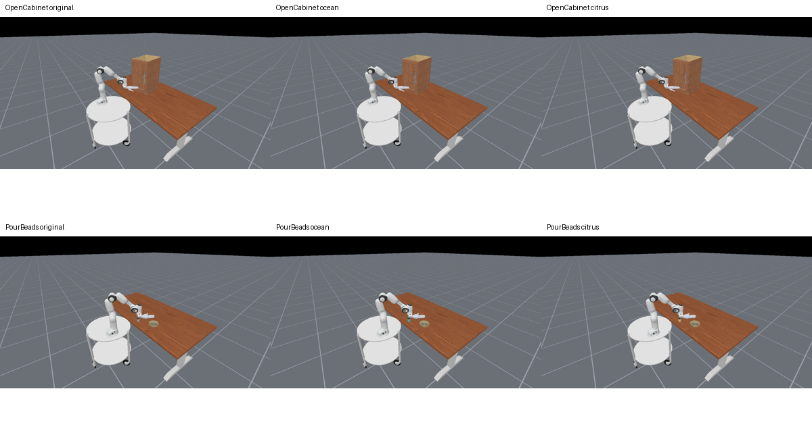
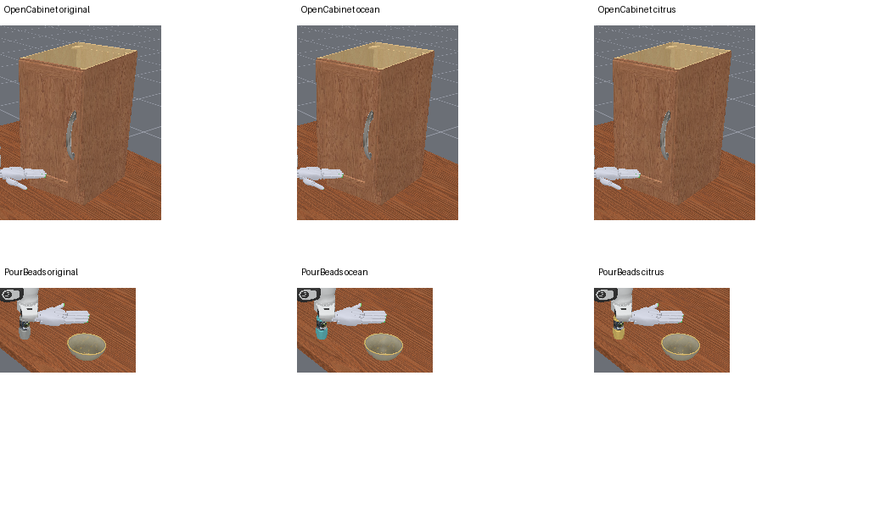

# 最新补充入口

[visual_fix_001：最小修复准备、诊断失败，正式回归未运行](visual_fix_001/README.md)。下方为job88174的历史证据，不能作为v1.2通过结论。

# Cabinet 剩余对象：作业 88174，视觉交验受阻

运行提交 `030a6119025d39c520eebbfc6cf18b9d44e18130`（生产实现 `d2bace247fba289265ca3bc7d3394bc2956bf851`）。单卡 physx_cuda；四短任务各 2 环境，Long 1 环境。分配 74 秒，COMPLETED / 0:0。**进程正常结束和自动断言通过不等于外观验收通过。** PR #10 保持草稿、待 Dennis 审验，未合并。

[精简结构化证据](runtime_001.json)保留实际检查结果、源文件哈希、逐任务环境数、材质部件数、随机序列、局部 reset 像素差及视觉审计结论。完整原始结果、状态／物理快照、manifest 和收据由维护者保存在本轮交付中，未将缓存或整套运行目录上传。

| 正式 Sharpa 任务 | 实际对象 | 自动参数／恢复／物理初态／随机记录 | 两轮 env1 局部 reset | 实景验收 |
|---|---|---|---|---|
| CabinetPouringOpenCabinet-Sharpa-v1 | 柜体 | 通过 | env0 状态、材料、纹理、目标、RNG、记录、四路图像不变 | 柜体预期配色未实现，失败 |
| CabinetPouringPickBottle-Sharpa-v1 | 柜体、珠子 | 通过 | 同上，四路图像不变 | 柜体视觉阻断；珠子独立视觉未确认 |
| CabinetPouringUnscrewCap-Sharpa-v1 | 珠子 | 通过 | 同上，四路图像不变 | 珠子独立视觉未确认 |
| CabinetPouringPourBeads-Sharpa-v1 | 碗、珠子 | 通过 | 同上，四路图像不变 | 碗预期配色未实现，失败；珠子未确认 |
| CabinetPouringLong-Sharpa-v1 | 三者 | 单环境自动检查通过 | 不适用，未绕过原限制 | 同样受视觉阻断；阶段切换仅工程触发 |

“自动通过”包括 original/ocean/citrus/violet 的实际材质 getter、保留纹理和透明属性、候选切回 original、关闭外观与 original 的物理／几何／数量／初态对照。珠子每环境 16 颗的实际材质、Actor.merge 后物理与状态索引通过；这不能代替看清单颗珠子的 RGB 证据。PickBottle/UnscrewCap 的 xy_v2 合法固定点和瓶／盖 A/B/C、附着／自由盖工程检查通过；未改变区域或成功门槛。

## 必须保留的视觉阻断

柜体和碗在同 seed、同相机、同光照图片中仍接近原木色／原碗色，未呈现 catalog 预期的蓝绿柜、暖白碗、暖木柜、深绿碗。材质 getter 确实已写入，但渲染结果不足以交验。保存的柜体 ROI 中 ocean/citrus 与 original 的最大通道差分别仅 7/5（8 位）；这是描述数据，不是新设的通过阈值。碗 ROI 也只有很小变化。不能用整帧变化证明某个对象颜色正确，尤其同一帧中瓶身本就发生变化。

当前未确认问题发生在纹理／颜色组合还是批量渲染更新环节；**没有运行或修改新探针、生产代码、着色器或共享库**。珠子在当前保存视角的容器遮挡下尚不能逐颗确认目标颜色，不按视觉通过处理。后续需 Dennis 确认针对性修复／补证范围及新作业机会；本次一次提交机会已经消耗，不自动复测。

以下均为作业真实图。总览是缩小拼接，细节是固定 ROI 裁剪，没有重绘或生成预览。原始全帧也保留：

- 柜体：[original](OpenCabinet_original_human_0.png)、[ocean](OpenCabinet_ocean_human_0.png)、[citrus](OpenCabinet_citrus_human_0.png)。
- 碗／珠子所在任务：[original](PourBeads_original_human_0.png)、[ocean](PourBeads_ocean_human_0.png)、[citrus](PourBeads_citrus_human_0.png)。
- Long：[original](Long_original_human_0.png)、[ocean](Long_ocean_human_0.png)、[citrus](Long_citrus_human_0.png)。

## 边界与终态

没有用户物理步进、机器人完整任务成功、训练、A6 或大规模并行验证；框架内部 GPU warm-start 属原生初始化，不主张修复前后内部轨迹等价。日志保留 Vulkan ICD 警告和原生 PhysX oblong convex hull cooking 警告；后者由 SAPIEN 自带路径继续执行，未改核心或物理参数，也不据此宣称任意碰撞形状兼容。

运行后 670 个源码文件、627 个资产文件及私有依赖身份保持。原 PGID 已退出、队列监视器已退出，本线队列空。应用日志 1,754 字节；目录采样峰值 193,572,731 字节，最终 193,574,485 字节，71 次采样。768 MiB 是采样停止阈值，**不是硬配额**；跨 PGID 后代与全部驱动写盘边界仍未证明。

对象总表保持原验收计数：自动参数检查和隔离通过不将三个对象升为 accepted_pilot。历史未运行报告、失败的只读 CPU 探针及本次完整证据均保留。
