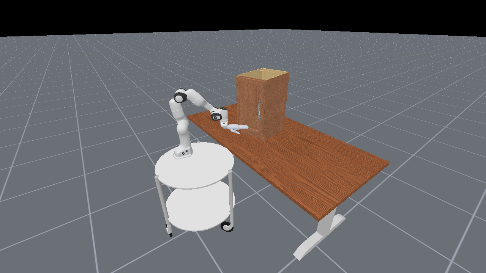
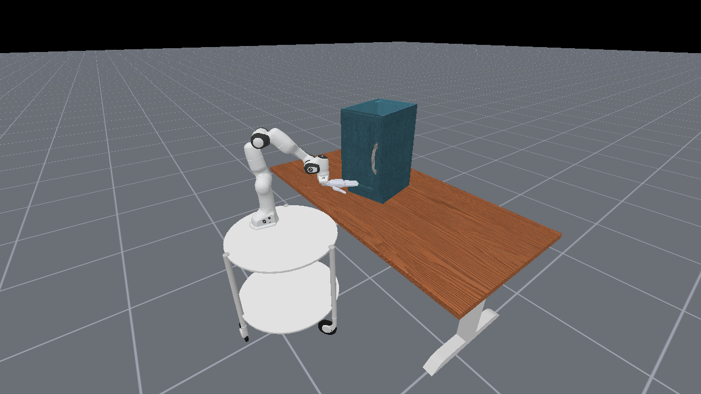
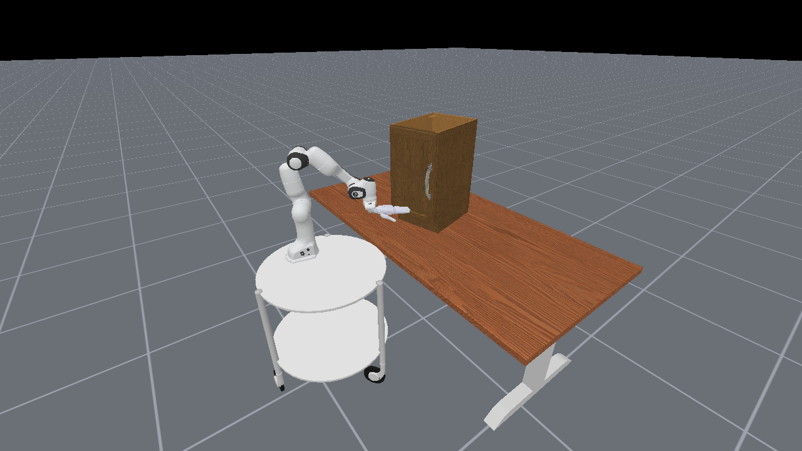
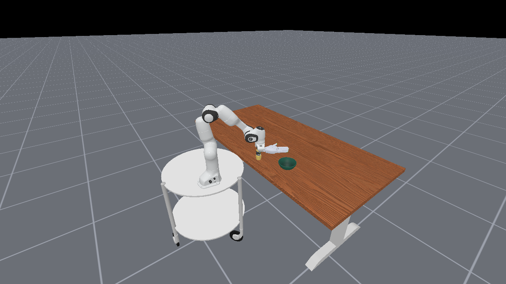
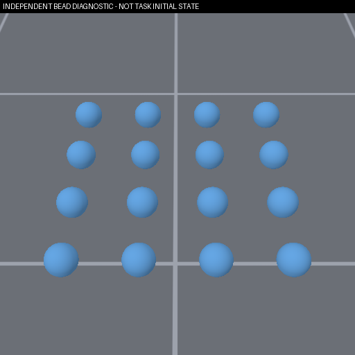
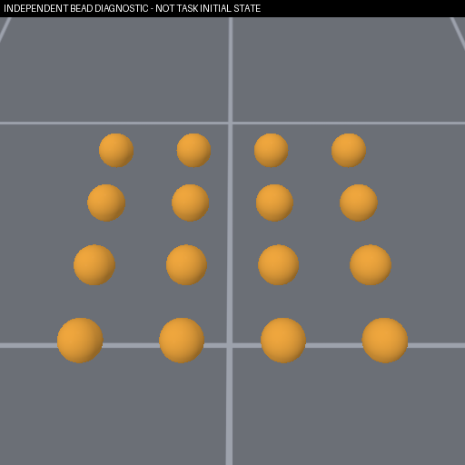
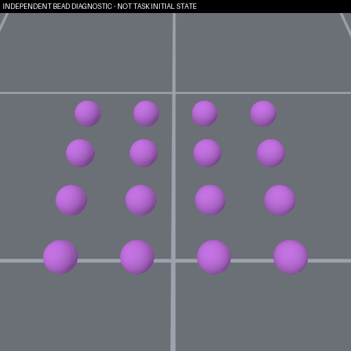

# Cabinet 外观修复：限定运行与视觉检查通过

最终运行源码 `a18cd0e26708fe2f39ff12a8a84c28735571039a`，作业 **88777**，113 GPU分配秒。四短任务各2环境、Long单环境全部通过；leader检查真实图片确认配色与原版把手。待Dennis最终查收，PR #10未合并；对象验收计数暂不增加。

## 问题与修复

1. 当前着色器对带贴图材质不使用baseColor，原标量改色不能得到预期配色。沿用原UV，以原纹理亮度生成Ocean/Citrus派生贴图，保留细节与alpha；来源许可仍随原资产。
2. 新实例能正确显示派生贴图，但批量渲染开始后替换贴图引用不能可靠刷新。每个环境在首次渲染前绑定自己的稳定纹理对象，reset时用`RenderTexture2D.upload`更新像素，original/violet写回原像素。没有增删渲染组件，也不改SAPIEN或ManiSkill。
3. 柜门把手`original-36.obj`原来被“有纹理”规则误归为木面；现在显式保留原材质，并逐材质与原版对照。原瓶/盖参数、UV、几何、物理、位置范围及成功条件保留。
4. 旧探针在运行中移除贴图，再由无画面变化推断表面不可见，不能区分绑定问题和更新问题。现在使用新实例同条件对照、同实例切换对照及实际纹理像素哈希。

## 实测结果

| 正式Sharpa入口 | 环境数 | 实际加载的新对象 | 结果 |
|---|---:|---|---|
| OpenCabinet | 2 | cabinet | 通过 |
| PickBottle | 2 | cabinet、beads | 通过 |
| UnscrewCap | 2 | beads | 通过 |
| PourBeads | 2 | bowl、beads | 通过 |
| Long | 1 | cabinet、bowl、beads | 工程检查通过 |

- 原版/Ocean/Citrus/Violet、恢复原版、材质绑定、几何/物理/初态、随机复现和记录通过。每个环境的可变纹理独立；柜门把手原材质保持。
- 柜体与碗的候选像素变化达到预设阈值；同实例切换和对应新实例ROI的最大通道差均为0。原纹理细节仍可见。
- 四短任务各两轮只reset env1：env0状态、材料、记录、随机流和四路RGB均不变（所有像素差0）。
- 珠子使用原生4mm球、16颗，独立近景蓝/橙/紫与局部隔离通过；图注明独立诊断，未改变正式任务初态，未把球放大冒充效果。投影内区每个方案/环境有10110个匹配颜色像素。
- 原瓶/盖工程阶段切换、既有xy_v2合法点必要回归通过。未执行用户物理步，框架仍可能内部warm-start。
- 运行前后705个源码文件、627个源资产及15项依赖一致；责任进程组、队列监视器均退出，本线无排队/运行作业。终态另有两项健康训练不属于本线，未干预。

这不是完整机器人任务成功、训练、A6、Long双环境、其它手型或长期压力结论。阶段切换为工程触发。保留驱动/PhysX原有警告；本轮实际加载和渲染成功不代表消除所有上游问题。

## 真实对照图

以下同任务图使用相同seed、相机和光照；珠子行是独立诊断场景。

| 对象 | original | ocean | citrus |
|---|---|---|---|
| 柜体（把手原版） |  |  |  |
| 碗 |  |  |  |
| 独立珠子 |  |  |  |

## 证据与计账

可移植证据仅将个人安装路径前缀换为占位符；原始文件hash及原件在本地保留，测量值不变。[精简结果](results.json)、[完整材质断言结果](results_full.json)、[视觉测量](visual_evidence.json)、[运行manifest](manifest.json)、[源码/依赖身份](runtime_identity.json)、[调度与清理终态](terminal.json)、[停止监督器](guard_receipt.json)、[容量采样](capacity_result.json)、[本轮成本](costs.json)。原始693份运行文件留存在已批准的Ceph目录，选定235份终态/JSON/human图已取回D盘；本目录仅保留审阅所需部分。

五次作业17+17+112+1+113=**260/300 GPU分配秒**。前三次逐步定位更新问题，第三次脚本通过后人工发现把手误染；第四次因我遗漏监督器工作目录在应用启动前失败，新增1秒，修正路径并CPU实测完整启动路径后，第五次通过。每次新增作业均获Dennis明确授权，不掩盖失败或历史超支。

最终采样峰值725964155字节，768MiB采样停止线保留；不是硬配额。应用日志1754字节。所有本地收集位于D盘，沿用已批准Ceph路径与采样越限风险。未清理历史项目数据或影响其它作业。

历史：[首轮视觉未达标](../README.md)、[旧可见性探针失败](../visual_fix_001/README.md)。这些是历史结论，当前以本次固定版本和实景为准。
