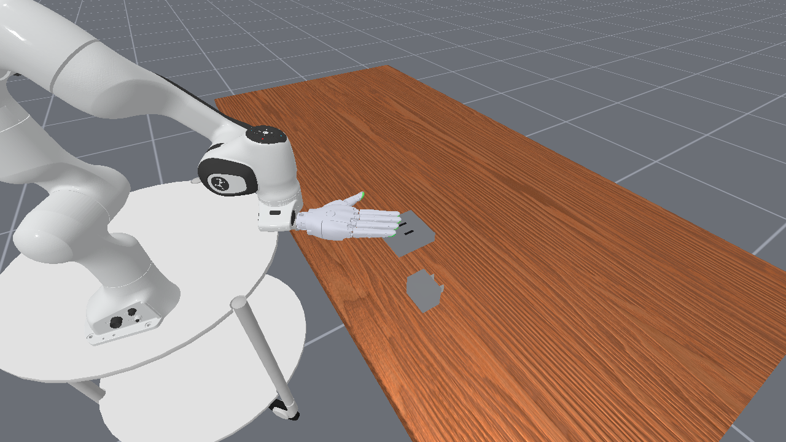
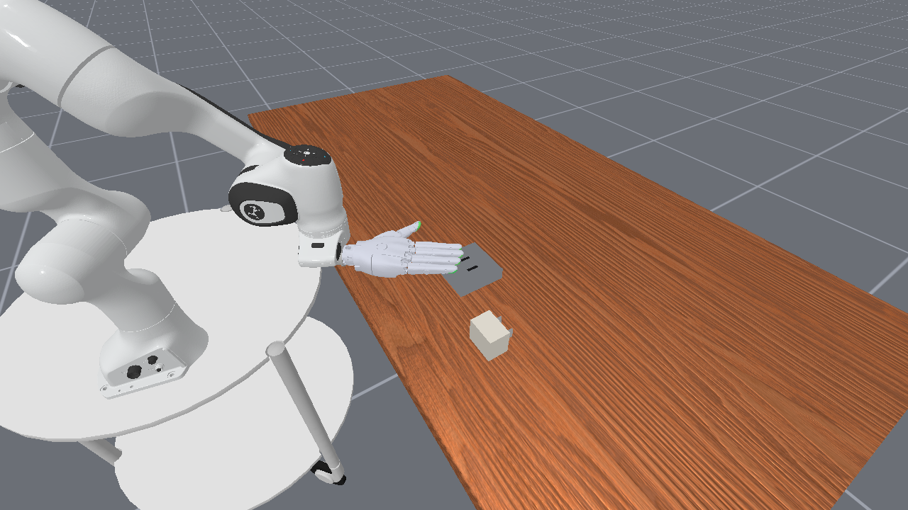
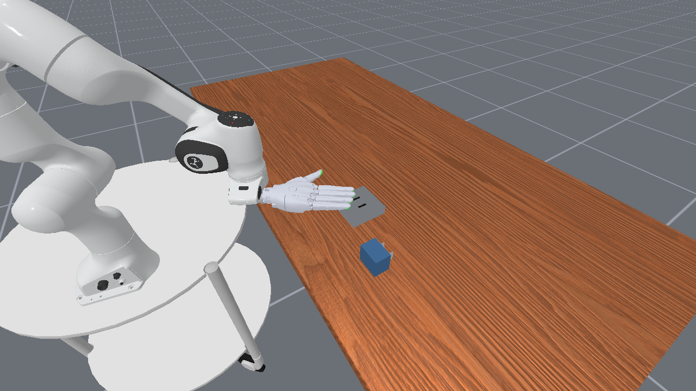
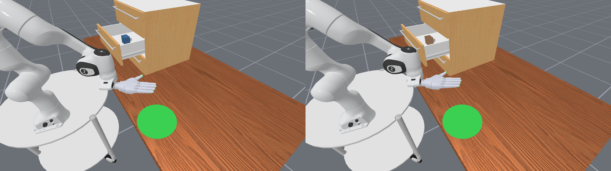
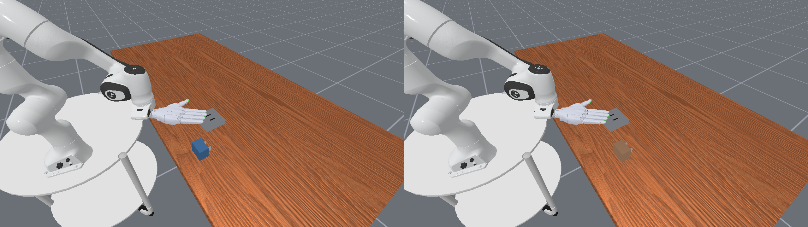
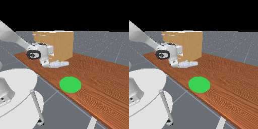
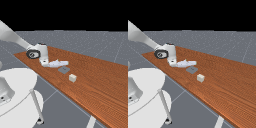

# Charger A4／A5本轮原RGB证据

这些是本轮正式任务、原相机的GPU实景，不是Bob A3历史预览，也没有新建相机／改图／重渲染。测试提交38b847444b6d2587068348e0047f09e33b98f2e8、seed7、每任务2env；单次分配29秒。完整状态和48张原相机PNG另行交付，Git只保留必要原图与[结构化实测摘要](results.json)。

## InsertPlug四固定方案，同seed／相机／初态

| original | ivory_matte | navy_satin | copper_metal |
|---|---|---|---|
|  |  |  |  |

两任务四方案的本体／两插脚实际材质均按catalog逐字段核对，几何／碰撞／接触材质／质量／惯量与原生一致，完整初态逐值一致。PickCharger四固定方案的原图也在完整交付中，本页以下展示其实际局部reset换色。

## env1选中：左reset前，右reset后

navy_satin→copper_metal，仅reset env1。机器人姿态及物体位置变化为**选中环境原生reset**，没有修改机器人初始化；不将选中环境的自然初始化变化当作隔离失败。

PickCharger：

InsertPlug：

## env0未选：左reset前，右reset后

env0保持ivory_matte，完整物理状态、主体／双插脚材料和其全部回合记录不变。以下为原base_camera；**三路RGB及human**全部像素差均0，不只检查这两幅图。比较期间无物理步进、相机不动。

| PickCharger | InsertPlug |
|---|---|
|  |  |

结构化结果中的实际材料是测量快照，唯一方案参数仍由[Bob catalog](../../../../tasks/assets/variation/drawer_plug/v1/catalog.json)维护。成功判定仅作源码不变和初态对照，未构造或执行完整任务成功；未训练、未作A6或大规模验收。
