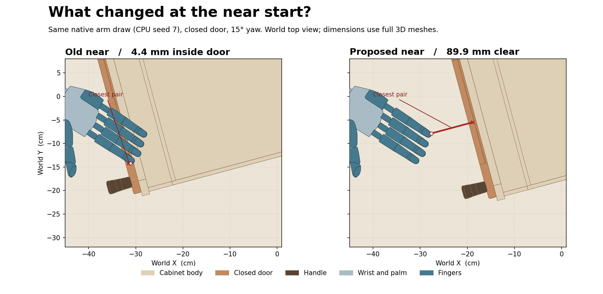

# OpenCabinet: clearance before the operator moves

**Current repair.** The opt-in public reset now screens every requested start before ManiSkill changes the scene. The recorded 59.31 mm rejection preserved both CPU rows, and both matched-control sequences passed. [CPU evidence and pending CUDA check](rejected_reset_repair/RESULTS.md)

**GPU follow-up.** Job 142378 reproduced penetration at the two old starts. The corrected near request was explicitly rejected and far cleared the geometry screen. Passive state changed on the subsequent local reset, which stopped the run. [First-frame results and remaining blocker](runtime_001/RESULTS.md)

The old near and right starts intersect the closed door in the reconstructed collision meshes. The old left start is separate but leaves only 35.90 mm at the neutral posture. This change tests the actual noisy arm posture before accepting a cabinet root and also tests a path from that posture to pre-grasp. The scope is the opt-in left Sharpa OpenCabinet task on main `54ba60d3e700a7d56022696e554f6ef20130a858`.

## Reproducing the five old starts

The five cabinets use 15° yaw, zero door angle and the same hand in each column. The native nominal control fixes the cabinet centre at (14, 12) cm. The seed-7 column uses the task's native Torch CPU arm draw with 0.02 rad joint noise, before any controller command. Millimetres marked “inside” are depths of an actual hand-mesh point inside a closed convex cabinet piece. Surface separation is zero in those rows. The depths do not estimate how far the entire cabinet must move to clear the whole hand.

| Old placement | World root XY (cm) | Neutral posture: closest pair / gap (mm) | Native arm draw, CPU seed 7: closest pair / gap (mm) |
|---|---:|---|---|
| near | −8.5, 5.5 | Index distal / door 4, **6.59 inside** | Index pad / door 4, **4.40 inside** |
| far | 9.5, 5.5 | Little finger distal / door 0, 117.53 | Little finger distal / door 0, 121.45 |
| left | 0.5, 14.5 | Little finger distal / handle 15, 35.90 | Little finger distal / door 4, 50.01 |
| right | 0.5, −11.5 | Little finger distal / door 2, **2.94 inside** | Little finger distal / door 2, **5.41 inside** |
| native nominal | 14, 12 | Little finger distal / handle 14, 157.67 | Little finger distal / handle 14, 177.73 |

The narrow geometry test uses the registered left hand URDF's wrist, bracket, palm and five fingers and the cabinet's exported collision pieces. The cabinet geometry export is SHA-checked against the previous investigation and its door is transformed from the measured open pose back to closed about its hinge. The diagnostic first finds overlapping boxes, then tests actual hand triangles against the cabinet hulls and computes nearest points in 3D. The raw files distinguish box counts, positive separations and interior witnesses. These are CPU reconstructions. The previous simulator measured handle and root positions, but its results contain no first-frame hand-link capture. A synchronized frame from Dennis's glove session was unavailable. [Neutral raw measurements](old_starts.json) · [Noisy reset measurements, link matrices and witnesses](cpu_audit.json) · [Original simulator measurements](../open_cabinet_reach/runtime_001/RESULTS.md)



## Placement rule and retained variation

* At reset, `MIN_START_CLEARANCE_MM = 60` applies to the wrist, palm and every finger against the door, handle and cabinet body. It exceeds both measured cramped left gaps (35.90 and 50.01 mm). It is a proposed starting distance for Dennis to judge with the glove.
* From the actual sampled arm pose to the 45 mm pre-grasp standoff, `MIN_APPROACH_CLEARANCE_MM = 12` applies to the same parts, including finger–handle clearance. A smaller threshold here allows deliberate approach. We use a straight interpolation in joint space, bound each of 32 intervals using its endpoints plus a curvature allowance, and check enclosing boxes in cabinet coordinates. We validate the interpolated pre-grasp against 1 mm and 0.75° tolerances. The guard screens one approach path. A human can follow a different one.
* The 1 cm IK inset in green measures distance to the arm's reach limit. The original grasp and pull screen to 80° supplies the outer candidate cells. Its intended finger contact applies at grasp and during the pull. No finger contact is exempt at reset or on the screened approach.
* The map uses 1 cm square cells with all four corners and centre tested at neutral. Each request is screened again at its actual continuous XY and its actual sampled arm pose. Random requests draw from the selected environment's own stream, up to 48 candidates with the same robot posture. A failed fixed request raises a `ValueError` naming the request and environment. Native and PR #32 coordinate resets keep their previous behavior.

| Yaw | Old cells | Retained cells | World X, Y extents of retained roots (cm) | Depth × lateral span |
|---:|---:|---:|---|---|
| 10° | 487 | 20 | [6, 10], [−5, 6] | 4 × 11 cm |
| 15° | 554 | 74 | [5, 12], [−5, 16] | 7 × 21 cm |
| 20° | 641 | 181 | [2, 14], [−2, 24] | 12 × 26 cm |

The ranges are the extrema of irregular regions. Use the blue cells for the actual shape. The door enters the starting hand envelope on the near side. The inherited handle reach and pull screen limits the far side. Removing cells conservatively also excludes some placements that could work with another approach. [10° map](yaw_10.png) · [15° map](yaw_15.png) · [20° map](yaw_20.png)

## Four headset placements

At 15° the comparison pairs isolate translation. Depth spans **5 cm** (previously 18), lateral travel spans **13 cm** (previously 26). For preset selection only, neutral centres needed another 18 mm of starting headroom and 2 mm of approach headroom. We selected the longest aligned pairs among those centres, then used the regular 60/12 mm thresholds at each real request. The approach and start minima below are conservative enclosure separations over accepted draws, independently minimized.

| Preset | Root XY (cm) | Seed-7 mesh gap (mm) | Minimum start / approach (mm) | Accepted / 128 |
|---|---:|---:|---:|---:|
| near | 6.5, 4.5 | 89.89 | 60.13 / 27.49 | 125 |
| far | 11.5, 4.5 | 138.18 | 84.68 / 28.81 | 128 |
| left | 8.5, 15.5 | 126.24 | 60.96 / 29.74 | 126 |
| right | 8.5, 2.5 | 104.03 | 65.97 / 28.78 | 127 |

Across the fixed, 192 interior and tested boundary cases the lowest accepted start bound was **60.13 mm**, near at seed 27, little finger distal / door 0. The lowest approach bound was **21.10 mm**, seed 22, 10° random root (7.5298, 1.4194) cm, little finger distal / handle 12, sixth interval. Six fixed requests were explicitly rejected: near seeds 25/51/103, left 51/103 and right 103. All twelve boundary requests (four seeds at each yaw) cleared the screen. An exterior request was rejected at each yaw. Replaying the 192 interiors reproduced the series, and a separate session reproduced 32 consecutive locally reset roots and arm positions from one initial seeding. In each local direction the CPU stand-in preserved the other environment's root, arm posture and episode RNG. Full simulator isolation remains pending. [Raw CPU audit](cpu_audit.json)

## Activate in VR

Pass `{"handle_workspace": true}` as construction kwargs to the live launcher's Gym environment. Use a fresh episode reset to exercise it. In a one-environment session:

```python
import gymnasium as gym
import tasks

env = gym.make("CabinetPouringOpenCabinet-Sharpa-v1", handle_workspace=True)
obs, info = env.reset(seed=7)  # ordinary randomized placement
obs, info = env.reset(options={"handle_placement": {"0": "near"}})
obs, info = env.reset(options={"handle_placement": {"0": "far"}})
obs, info = env.reset(options={"handle_placement": {"0": "left"}})
obs, info = env.reset(options={"handle_placement": {"0": "right"}})
```

For exact CPU replay we controlled both the native Torch noise stream and the per-environment placement stream. A restored saved state can override a fresh reset in the VR launcher. If a fixed pose fails its clearance check, record its error including both distances. For the headset trial, please capture the uncommanded reset frame and first glove-commanded frame with the same episode ID, world link poses and timestamps. Compare fingertip clearance, room to begin the reach and continuity of the pull across both pairs.

## CPU reproduction

Use the original `stage2/geometry/runtime_geometry.json` as `EXPORT` below. The diagnostic checks its SHA before using it. From the repository root, with the existing CPU geometry environment:

```sh
python tools/variation/open_cabinet_reach/start_mesh.py "$EXPORT"
python tools/variation/open_cabinet_reach/screen_starts.py "$EXPORT"
python tools/variation/open_cabinet_reach/check_start_cpu.py "$EXPORT"
python tools/variation/open_cabinet_reach/start_figures.py "$EXPORT"
python tools/variation/check_static.py
```

## Separate GPU proposal for Dennis

Request **one single-card job**, 240 allocation seconds, 205 application seconds, up to 120 seconds in queue, 50 minutes total wall time including at least 15 minutes for handback. GPU use in this CPU round is zero. Run the [first-frame checker](../../../../tools/variation/open_cabinet_reach/check_start_runtime.py) on the registered two-environment `physx_cuda` backend. Read the actual wrist, palm, finger, door and body poses immediately after reset, before a step or glove command. Compare the four historical presets and native nominal, then the corrected presets, random resets and both directions of local reset. Distinguish actual mesh-vertex penetration from overlap of boxes. Record any named rejection and the passive environment's state and RNG. Dennis owns the live first-glove-frame comparison and the comfort decision.

* Proposed private Ceph root `/mnt/ceph2/xkl/DexArena/open_cabinet_start_clearance_20261125/`, output `runtime_001/`. Local logs `D:/Logs/DexArena/open_cabinet_start_clearance/runtime_001/`. Check resolved paths, source identity and free space immediately before submission.
* Expected evidence under 2 MiB, private run/cache growth under 64 MiB. Require at least 20 GiB free on Ceph and 10 GiB on D:. Sample the whole project root about once a second and stop at 128 MiB. Sampling can overshoot. Cap logs at 8 MiB and ordinary files at 64 MiB, disable core dumps, reuse read-only assets and dependencies.
* One submission, no retries or requeue. Cancel only this job on queue timeout. On an unexpected assertion, write or resource limit, preserve the first record, stop its process group, verify final queue/process state and return the receipt. A named fixed-pose rejection goes into the results. GPU execution and this storage risk await Dennis's approval.
