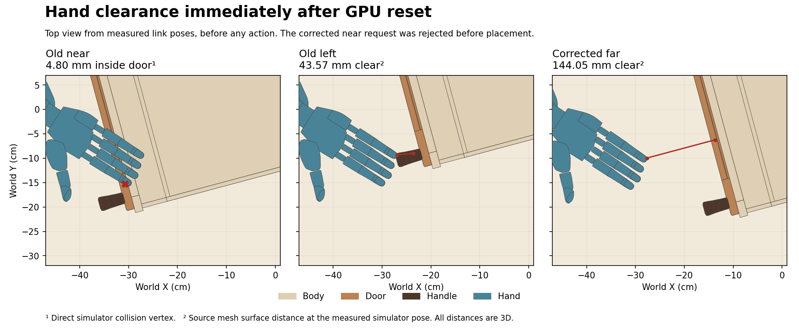

# First-frame simulator check: OpenCabinet hand clearance

**The old near and right presets penetrate the closed door in the simulator. The corrected sampler is still blocked on two-environment local-reset isolation.** The corrected near request was explicitly rejected for its sampled arm posture. The corrected far placement was clear, but the same reset changed the unselected environment's saved state.

Tested `c3e4b5361a16072e078a8c09ed9ecd605bdeb057` from draft PR #47, task `CabinetPouringOpenCabinet-Sharpa-v1`, two environments on `physx_cuda`. All captures are after reset, before any action, physics step by the checker, or glove command. The five historical controls used the old world roots with cabinet XY noise set to zero and native arm noise active. The controls have identical recorded arm joint coordinates. The candidate presets used the actual new opt-in sampler. [Source identity](source.json) · [Raw first-frame transforms, boxes, witnesses and reset results](observations.json)

## Results

| Request | Direct simulator reading | Source mesh gap at measured poses | Outcome |
|---|---|---:|---|
| Old near, env0 | Index distal vertex 4.80 mm inside door piece 4 | 0 mm | Mesh penetration reproduced |
| Old far, env0 | Collision boxes at least 117.10 mm apart | 117.88 mm, little finger distal / door | Clear |
| Old left, env0 | Collision boxes at least 29.70 mm apart | 43.57 mm, little finger distal / handle | Positive but small gap |
| Old right, env0 | Little finger middle segment vertex 1.43 mm inside door piece 2 | 0 mm | Mesh penetration reproduced |
| Native nominal, env0 | Collision boxes at least 144.06 mm apart | 161.97 mm, little finger distal / handle | Clear |
| Corrected near, env0 | Predicted start 50.76 mm and approach 23.92 mm | No new pose accepted | Named rejection at the 60 mm start limit. Env1 full state and RNG both compared equal |
| Corrected far, env1 | Measured box gap 142.75 mm at root (11.50, 4.50) cm, yaw 15.00°, closed door. Screen 137.87 mm at start and 28.91 mm on approach | 144.05 mm, little finger distal / door | Geometry clears the thresholds. Env0 state differs, env0 episode RNG compares equal |
| Corrected left and right | Unreached | — | Untested |
| Two ordinary local resets | Unreached | — | The setup reset constructed the opt-in batch. These planned checks have no first-frame evidence |

Positive box gaps are lower bounds from the live simulator's convex pieces. Penetrations above use actual vertices inside actual simulator cabinet hulls. The source mesh column is an independent CPU measurement from the saved link poses, URDF triangles and frozen cabinet collision geometry. The hand reconstruction agreed with each measured hand link to within 0.00046 mm over its enclosure corners. The figure uses these measured poses and original meshes. It is a geometric top view. The CPU seed-7 results from the earlier round used a different Torch backend and arm sample. The approach numbers screen a candidate path, without commanding hand motion. [Per-pair geometry audit](geometry.json)

## First failure and what the record supports

The checker selected env0 for near, compared passive env1 before and after the expected rejection, then selected env1 for far and compared passive env0. The latter comparison returned `passive_unchanged=false`, `passive_rng_unchanged=true` with `door_angle=-0.0` in the selected environment. These values were written before the line-107 assertion. The failed condition is the full-state comparison. No second job was submitted. [First exception](failure.txt)

The checker compared digests for the physical and task-state tensors in memory and retained only their aggregate equality. The first differing field, its magnitude, and whether it originated in the rejected reset or in the subsequent successful reset cannot be recovered from this run. In particular this evidence does not establish that the passive cabinet or hand moved. To distinguish those cases, retain labelled per-field values immediately before and after the rejected env0 request and the following env1 reset, for both environments, using the same two-request sequence before attempting the remaining cases. Dennis's comparison with the first real glove command is still pending.

## Resources and cleanup

Job `142378`, Server 3 (`lyg0295`), physical GPU 6. Slurm recorded FAILED, exit 1:0, allocation 19 of 240 seconds, no requeue or restarts. CPU preflight imported the frozen checker and exercised the screen without initializing CUDA. The application guard ran for 17.40 s, retained 2,743 bytes of log and reported no capacity stop. It sampled a peak of 51,245,058 bytes under the 128 MiB threshold. Terminal project occupancy was 51,245,654 bytes. Ceph had 503,035,461,632 bytes free immediately before submission and D: had 118,699,126,784 bytes free. The queue, process group and visible job cgroup were empty at collection. Slurm accounting database was unavailable, so elapsed allocation is from terminal scontrol. [Launch preflight](preflight.json) · [Allocation and post-run hashes](terminal.json) · [Guard](guard.json) · [Capacity](capacity.json) · [Submission](submission.json)
