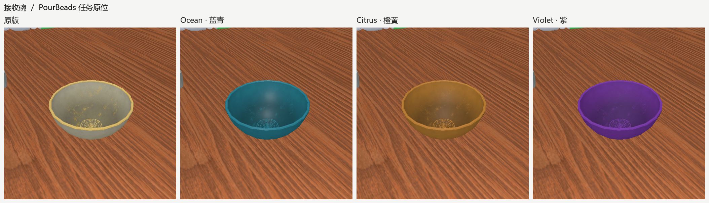
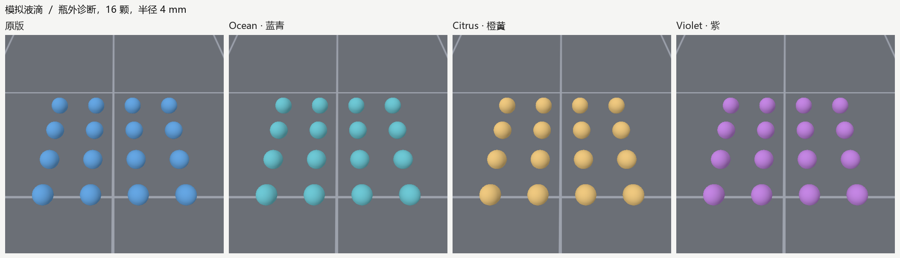

# PourBeads 的碗与模拟液滴

实测提交 `59496b28d849df6c6e6a0d74c0a08accbf42f47b`，作业 123817。两物体的工程短检通过，待审图。每列使用相同的相机、初态和任务光照，顺序为 original、ocean、citrus、violet。





## 使用

```python
env = gym.make("CabinetPouringPourBeads-Sharpa-v1", num_envs=2,
               pouring_appearance={"enabled": True, "scheme_id": "ocean"})
env.reset(options={"env_idx": torch.tensor([1], device=env.unwrapped.device),
                   "pouring_appearance": {"scheme_id": "original"}})
```

略去配置即使用原生路径。该入口同时控制接收碗与 16 颗模拟液滴。碗在内存中对使用者已有的漫反射图按亮度着色，保留纹样、UV 和透明度。球沿用原半径和实体，采用各环境私有的渲染材质。

## 实际验证

- 每组两个环境，分别构建原生实例和开启外观的实例。正式任务的碗在原位取景。珠子在独立的同任务实例内以 4 × 4 排在瓶外，零机器人步，固定相机取景。保留和正式实例相同的 16 个球和 4 mm 半径。
- 对同帧 RGB 和实体分割取交集。三个候选、两个环境共 12 个判色项全部通过。碗每帧的有效像素分别为 34,250 和 34,770，珠子均为 24,146，每项都完全命中预先固定的色相区间。每种方案均比对正式任务的碗和全部 16 颗球的材质。
- 物理初态与原生对照一致。恢复 original 后，两路传感器 RGB 与原生逐像素一致。只重置 env1 时，env0 的状态、材质和两路 RGB 均保持；env1 的目标对象确实变为紫色。
- 完整倾倒成功、训练、Long 和 A6 均未运行。瓶外图仅供辨色；正式任务保留瓶内初态。

[逐项计数与原帧 SHA-256](RESULTS.json) · [作业收据](JOB_RECEIPT.json) · [运行检查器](../../../../tools/variation/check_pouring_appearance.py)
